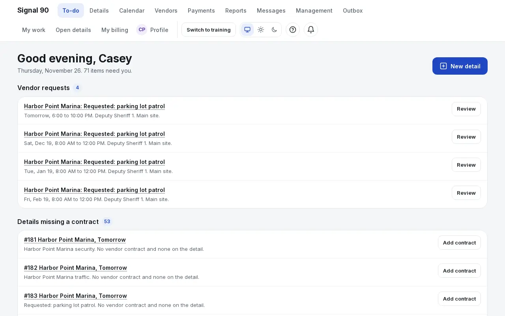
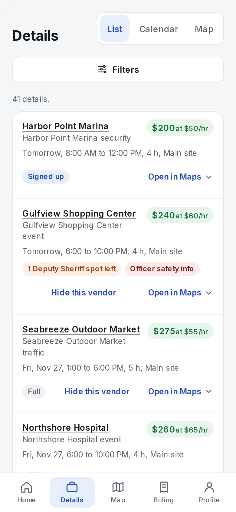

# Extra Duty

Extra Duty schedules and bills off-duty details for a law enforcement agency. Vendors (businesses, churches,
schools and event organizers) request officers for an event or a job site. Deputies sign up first come, first
served under the agency's rank, hour-cap and billing rules. After the detail, the deputy bills the vendor with an
emailed PDF invoice. The vendor pays the deputy directly, so the agency never holds or routes detail money.

The agency hosts the app itself. It is a web app that installs to a phone's home screen, with day and night themes.

  
  

## Features

- **Details.** Positions by rank, flexible times, officer safety notes and addresses, attachments and contracts,
  copies and recurring series, quick and bulk edits, and hold and release.
- **Monthly release.** Details open on a set day and time each month, or right away.
- **Sign-up rules.** Rank eligibility, hour caps (rolling 24 hours, week and month, by season), overlap checks,
  suspensions, and a lock for deputies with unbilled details. Every block says which rule applies and how to clear it.
- **Backups and cancellations.** Backup offers, late-cancel pay, no-shows and reactivated details.
- **Billing.** Hours reporting, invoice review, PDF invoices with an optional W-9, sending on a schedule or in
  batches, and payment tracking with a payment-issue process.
- **Vendor portal.** Vendors request details, see who is assigned, download invoices and contracts, and mark
  invoices paid.
- **Ops plans.** Plan submission, review and a library of past plans.
- **Maps and addresses.** OpenStreetMap maps and address checks, with links to Google Maps, Apple Maps and
  OpenStreetMap.
- **Alerts.** In-app inbox, email and web push, with agency-wide and personal switches.
- **Reports.** Activity, billing, tax summaries and CSV or PDF exports.
- **Training mode.** A separate practice database with demo data, reset every night.
- **Security.** Two-factor sign-in by emailed code, encrypted W-9 files, an audit log, and records that are
  deactivated rather than deleted.
- **API.** A REST API with API keys and an OpenAPI description.
- **Manuals.** Deputy, coordinator and admin, and vendor manuals in the app's Help pages and as PDFs.

## Quick start (Docker Compose)

Requires a Linux machine with Docker Engine and the Compose plugin.

    git clone <this repository> extra-duty
    cd extra-duty
    cp .env.example .env
    cp app.env.example app.env
    chmod 600 .env app.env
    # Fill in .env and app.env: domain, secrets and the first admin's email address.
    docker compose up -d --build

Then sign in as the first admin, set up email, and fill in the agency profile (name, sheriff, address, phone and
logo) under Admin. Every agency-specific value is a setting.

- [docs/self-hosting.md](docs/self-hosting.md): install, first sign-in, HTTPS, backups, updates, restore and key
  rotation.
- [docs/operations.md](docs/operations.md): settings, environment variables, the release path, and the production
  and staging deployments.
- [docs/manuals](docs/manuals): the user manuals in Markdown, with screenshots. Build the PDFs with
  `npx tsx scripts/build-manuals.ts` (written to `docs/manuals/pdf/`, which is not committed).

## Known assumptions

- **Time zone.** Agency time is fixed to America/Chicago (`AGENCY_TZ` in `src/domain/time/agency-time.ts`, and in a
  few date formatters). Release times, hour caps, billing locks and date-only API inputs all use it. An agency in
  another time zone must change it in the code for now.
- **United States.** Addresses, phone numbers (10 digits) and the W-9 tax form are US formats.

## Development

Requires Node 24 or newer.

    npm install
    npm rebuild embedded-postgres @embedded-postgres/linux-x64

The rebuild step links the embedded Postgres binaries after a fresh install (use the platform package for your
system).

Copy `app.env.example` to `.env.local` and fill in values, including the database and storage lines at its end.

    npm run dev          # development server on http://localhost:3000
    npm run build        # production build
    npm run worker       # background job worker
    npm run db:migrate   # apply migrations to DATABASE_URL
    npm run db:seed      # idempotent seed data (set SEED_ADMIN_EMAIL)
    npm run db:generate  # generate a migration after editing src/db/schema

`scripts/preview.sh start` runs a long-lived local preview (embedded Postgres and a production build) on
http://localhost:3210; set `PREVIEW_URL` to reach it from another machine.

The preview's demo accounts and the screenshot capture's practice deputy sign in with `DEMO_PASSWORD` from your
shell. Without it each run picks a random password and prints it once (the preview also keeps its first one in
`.local-preview/demo-accounts.txt`). The end-to-end tests pick a new random password on every run.

## Tests

    npm test                  # unit and integration projects (Vitest)
    npm run test:unit
    npm run test:integration
    npm run test:e2e          # Playwright

Integration tests start a throwaway Postgres through `embedded-postgres` (see `tests/setup/db.ts`); no external
database is needed. The end-to-end server builds the app into `.next-e2e` and seeds its own database.

`tests/e2e/flows/` walks whole jobs across roles: vendor, coordinator, admin and deputy each in their own browser,
signing in with the codes the app emails to a test mail catcher. These run as the `flows` project and record a video
and a trace of every test. `E2E_FIREFOX=1` adds Firefox projects when Firefox is installed.

    npm run test:e2e -- --project flows   # only the flows
    E2E_REUSE_BUILD=1 npm run test:e2e    # reuse the last e2e build; leave it off after changing app code

Three scripts serve the tests on port 3211, so you can watch them from another computer. Each runs until it
finishes or you press Ctrl+C.

    scripts/e2e-ui.sh       # Playwright UI mode
    scripts/e2e-record.sh   # record every flow spec, one at a time, into a dated run folder
    scripts/e2e-report.sh   # serve the newest recorded run's report

Recorded runs go to `.local-preview/e2e-runs/<YYYY-MM-DD-HHMM>/` (git-ignored). Runs older than 30 days are
deleted, only the newest 10 are kept, and the oldest go first when the runs pass 3 GB together.

The manual screenshots come from demo data only: `scripts/capture-local.sh` starts the e2e server as a staging site
on the demo agency and runs `scripts/capture-screenshots.ts` against it.

## Contributing and security

See [CONTRIBUTING.md](CONTRIBUTING.md). Report vulnerabilities privately as described in [SECURITY.md](SECURITY.md).

## License

Copyright the Extra Duty contributors. Licensed under the GNU Affero General Public License, version 3 only
([LICENSE](LICENSE)). If you run a modified version for others over a network, you must offer them its source code.
