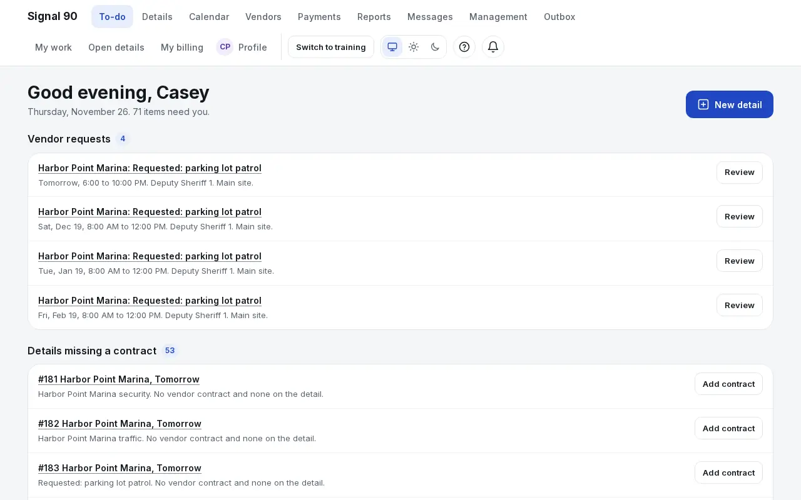
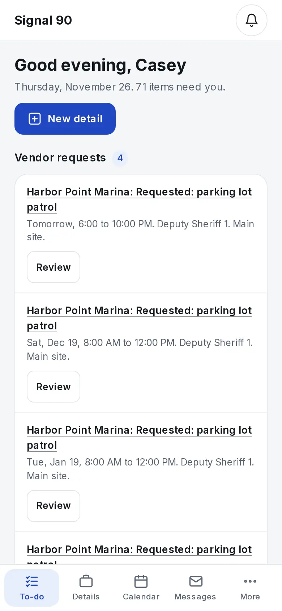

# Your to-do list

Coordinators and admins start on **To-do**. It lists everything that needs you, grouped by kind. Admins have every coordinator power, plus the email server, security and API keys.

1. Open **To-do**. Each group has a count: **Vendor requests**, **Details missing a contract**, **Invoices to review**, **Unfilled, starting within 72 hours**, **Sign-up locks**, **Left the agency: not billed** and more. Long groups end with a button such as **Show 47 more**.

   

2. Act from the row, such as **Review**, **Add contract**, **Approve and send** or **Lift lock**, or open the item for the full page.
3. Choose **New detail** to post a detail.
4. On a phone, the bottom bar has **To-do**, **Details**, **Calendar**, **Messages** and **More**. **More** has the other sections, your own work (**My work**, **Open details**, **My billing** and **Map**), **Profile**, **Help** and the training switch.
5. When you work details yourself, your own work is at the right of the top bar on a computer: **My work** (your sign-ups and alerts), **Open details** (sign up), **My billing** (bill your details and confirm payment) and **Profile** (your W-9, schedule, calendar link, goal, hidden vendors, theme and maps app). They work the same as in the deputy manual. When the **Sign-up locks** group lists you, its **Open my billing** button takes you to the details to bill or the payments to confirm.

   

> You also have every deputy power. The deputy manual covers signing up, billing and your own profile.
