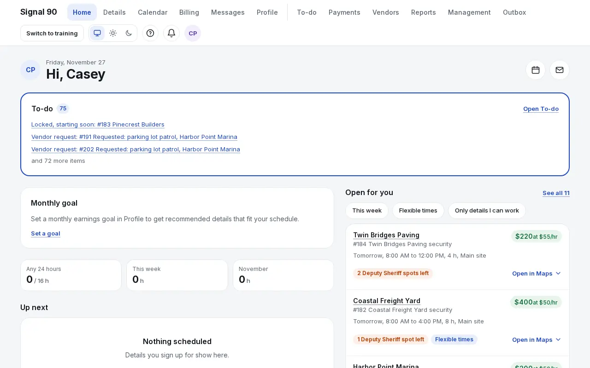

# Home, To-do and the shared screens

Coordinators and admins see the same tabs and pages as deputies: **Home**, **Details**, **Calendar**, **Billing**, **Messages** and **Profile**, in that order. Your staff work adds the tabs after the line: **To-do**, **Payments**, **Vendors**, **Reports** and **Management**. Admins have every coordinator power, plus the email server, security and API keys.

## Home

1. You start on **Home**, like a deputy. The **To-do** card at the top shows how many items wait on you and the first few of them. Choose an item to open it, or **Open To-do** for the whole list.
2. Below it are your own sign-ups, goal, hours and the details open for you. They work the same as in the deputy manual.

   

## To-do

1. Open **To-do**. Each group has a count: **Vendor requests**, **Details missing a contract**, **Invoices to review**, **Unfilled, starting within 72 hours**, **Sign-up locks**, **Left the agency: not billed** and more. Long groups end with a button such as **Show 47 more**.

   

2. Act from the row, such as **Review**, **Add contract**, **Approve and send** or **Lift lock**, or open the item for the full page.
3. Choose **New detail** to post a detail. When the **Sign-up locks** group lists you, its **Open my billing** button takes you to the details to bill or the payments to confirm.

## Your staff controls on the shared pages

- **Details** is the same list deputies use. You also get **New detail**, the **Upcoming**, **Requests**, **Canceled** and **Past** views, every status and person in the filters, each detail's number, and a box beside each detail for **Edit selected**.
- A detail's page opens on **Detail**, what deputies see (facts, sign-up, roster). Choose **Manage this detail** for your controls: request decisions, quick edit and edit, hold and release, cancel and reactivate, the roster and sign-up history with assign and remove, officer safety, the ops plan review, attachments and contract, activity, copy and repeat. A vendor request opens on **Manage this detail**.
- Every detail is named by its number: **#9** beside its title (lists, To-do, alerts, invoices) and **Detail #9** at the top of its page and in the audit log. Its address is /jobs/9; older links with a long id still open it. **Go to detail #** on **Details** opens a detail by number.
- **Calendar** keeps the agency-wide view and the people filter. **Billing** is your own billing; agency billing is under **Payments**.

## On a phone

The bottom bar has **Home**, **Details**, **Calendar**, **Billing** and **More**. **More** lists **Map**, **Messages**, **Profile** and **Help**, then your staff sections (**To-do**, **Payments**, **Vendors**, **Reports** and **Management**) and the training switch. Reach To-do from the card at the top of **Home**.

   

> You also have every deputy power. The deputy manual covers signing up, billing and your own profile.
