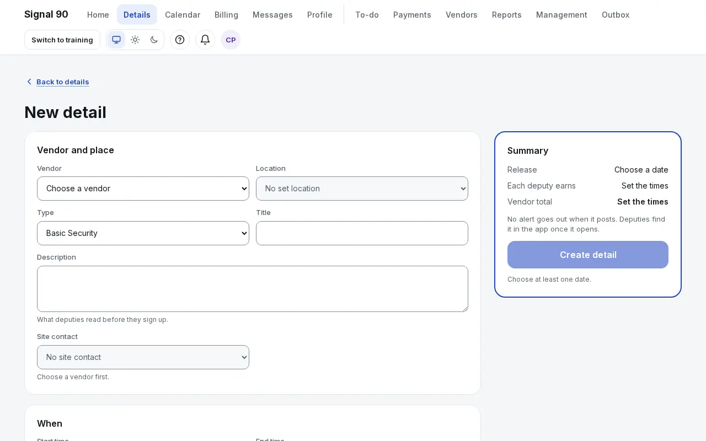
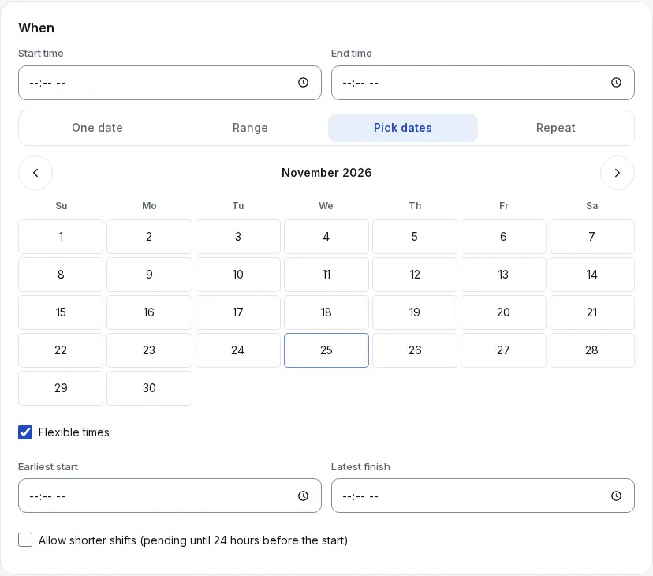
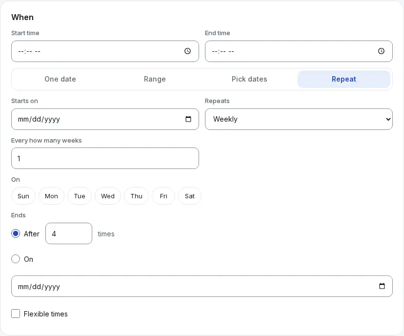
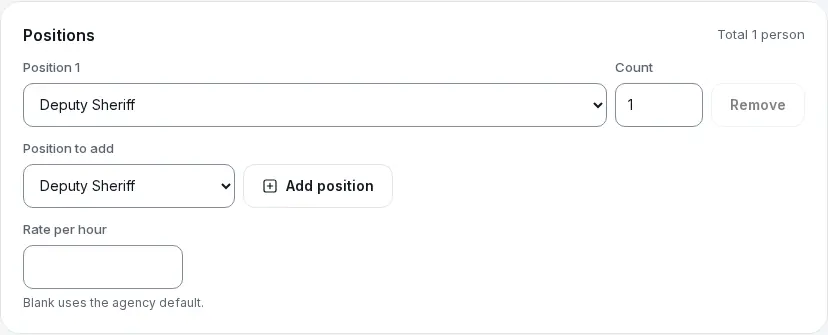
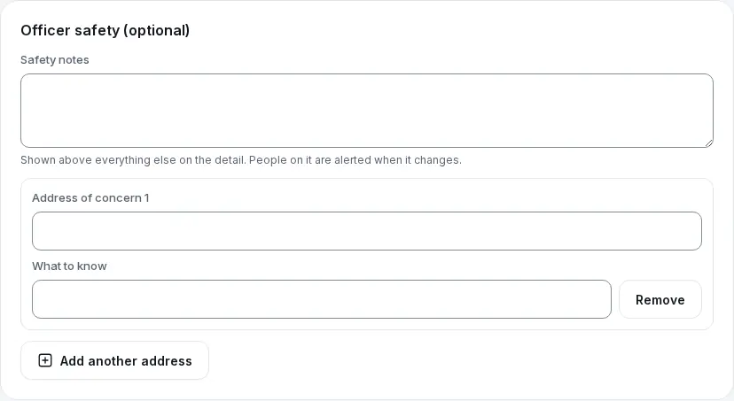
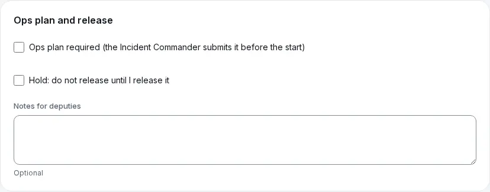
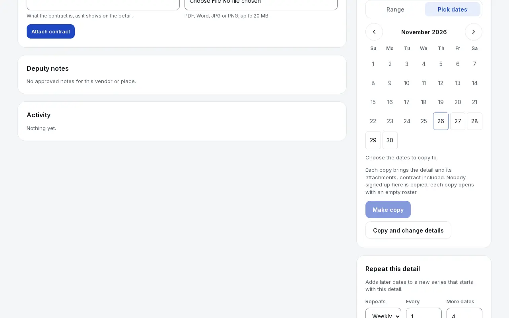

# Creating a detail

1. Choose **New detail** on To-do or Details. Under **Vendor and place**, pick the **Vendor**, the **Location** and the **Type**, give it a **Title** and a **Description** (what deputies read before they sign up), and pick the **Site contact**.

   

2. Under **When**, set the **Start time** and **End time**, then the dates:
   - **One date**, or **Range** for every day between two dates.
   - **Pick dates** to choose days on the calendar.
   - Tick **Flexible times** to let deputies choose their hours between an **Earliest start** and a **Latest finish**. Tick **Allow shorter shifts** if a deputy may work part of it.

   

3. For a series, choose **Repeat**. Pick **Starts on**, how it **Repeats** (daily, weekly or monthly), the days, and when it **Ends** (after a number of times, or on a date). Each date becomes its own detail.

   

4. Under **Positions**, pick each position and its **Count**. Use **Position to add** and **Add position** for a mix. Set the **Rate per hour**; blank uses the agency default. Some positions pay more. See [Position rate differentials](03-position-rate-differentials.md).

   

5. If there is a safety concern, fill **Officer safety (optional)**: the **Safety notes** and, with **Add an address**, each **Address of concern** and **What to know**. Deputies see it above everything else and are alerted when it changes.

   

6. Under **Ops plan and release**, tick **Ops plan required** if the Incident Commander must submit a plan, or **Hold: do not release until I release it** to keep it unreleased. Add **Notes for deputies** if needed.

   

7. Check the **Summary** and choose **Create detail**. No alert goes out when it posts. Deputies find it in the app once it is released.

## Copying a detail

On a detail's page, **Copy to other dates** makes copies. Pick the dates and choose **Make copy**. **Copy and change details** opens a new detail filled in from this one.

A copy carries the detail itself: the vendor, location and pin, title, description, notes, positions with their rate differentials, the rate, flexible times, officer safety notes and addresses with their pins, the site contact, and the attachments, contract included. It never carries people. Nobody signed up, on the backup list or working the original is copied, and nobody gets an alert. Each copy starts with an empty roster and releases under the normal rules. The same holds for the later dates of a **Repeat** series.

