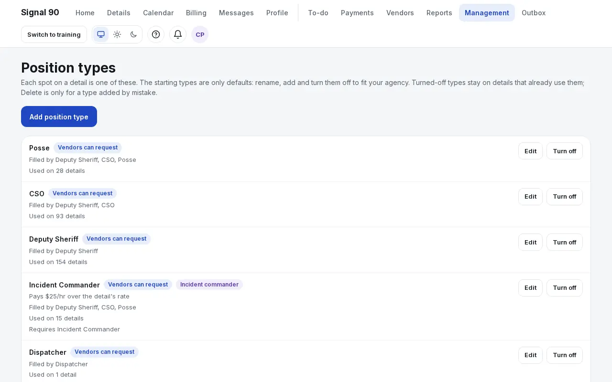
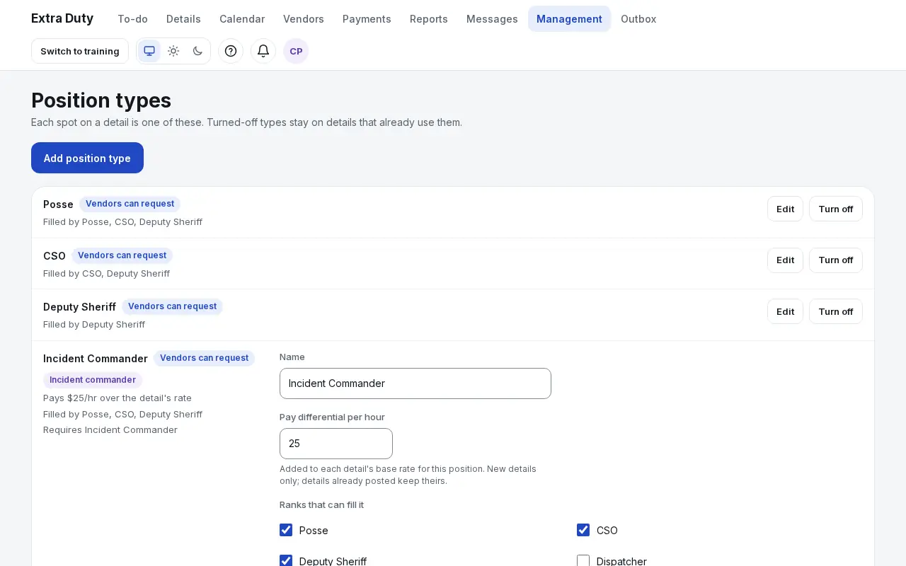

# Position rate differentials

A position can pay more than the detail's rate, such as an Incident Commander at $25 an hour over it. Deputies see the range in lists, and each person sees their own position's pay.

1. Open **Management**, then **Position types**. Each type says who can fill it and any extra pay, such as "Pays $25/hr over the detail's rate".

   

2. Choose **Edit** on the position. Set **Pay differential per hour**, tick the ranks that can fill it, and save. **Add position type** makes a new one.

   

The change applies to new details. Details already posted keep their pay.
