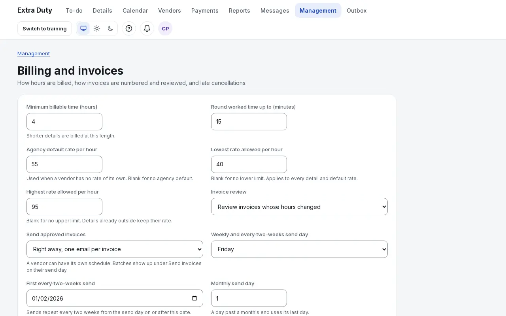

# The agency rate range and exceptions

The agency sets the lowest and highest hourly rate. A rate outside that range needs a coordinator's approval on that one detail.

1. Open **Management**, then **Billing and invoices**. Set **Lowest rate allowed per hour** and **Highest rate allowed per hour**, next to the **Agency default rate per hour** and **Minimum billable time**. Save.

   

2. When a detail's rate is outside the range, the form shows **Rate outside the agency range**. To approve it for this one detail, type a **Reason for the exception** and save.
3. An exception can be approved only on a single detail, not on several dates or a series.

The reason shows under **Manage this detail** on the detail page and in the audit log. It never prints on invoices. Details with an unapproved outside rate show on To-do under **Rates outside the agency range**.
