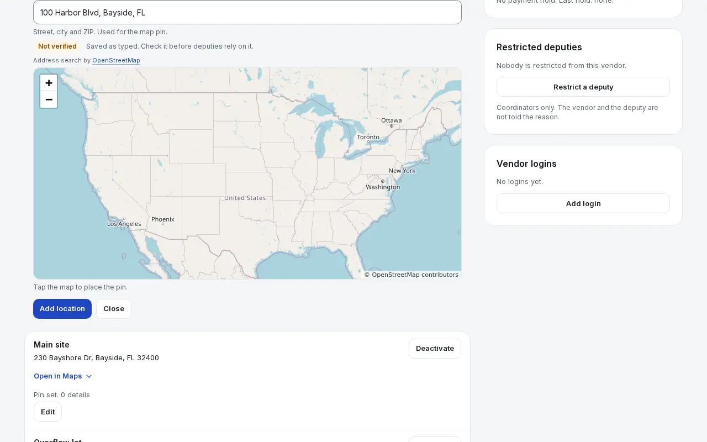

# Entering addresses

Addresses are checked against OpenStreetMap when you leave the field. The check never stops you saving.

1. Type the street, city and ZIP, then move to the next field.
2. Read the result under the field:
   - **Found on the map.** The address matched.
   - **Did you mean** a different address. Choose **Use suggested**, or **Keep as entered**.
   - **Not verified.** No match was found, or you kept your own text. The address still saves.

   

3. For a location or an officer safety address, a small map shows the pin. Drag the pin, tap the map, or use the arrow keys to put it exactly on the spot. A pin placed by hand is used instead of the lookup.
