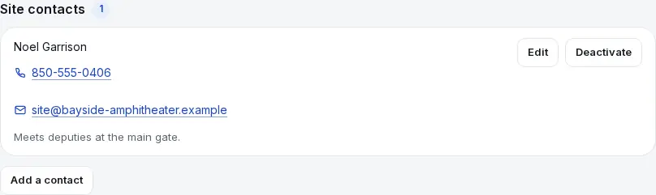
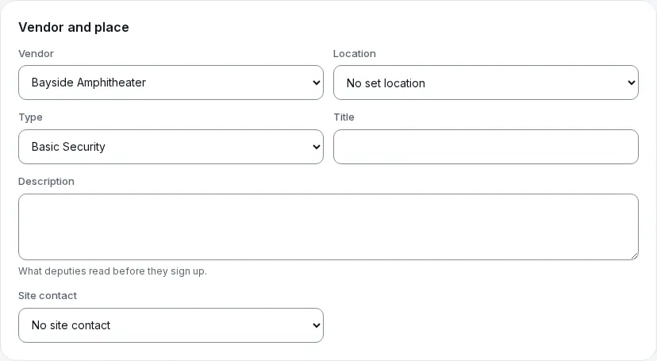

# Vendor site contacts

Each vendor keeps a list of site contacts: the people deputies ask for on arrival.

1. Open **Vendors** and the vendor. Under **Site contacts**, choose **Add a contact**, or **Edit** or **Deactivate** one. Names must contain a letter, and phone numbers must have 10 digits.

   

2. On a detail, pick the person under **Site contact**. Their phone fills in **Contact phone**, which you can change for that detail only. **Add a new contact** saves a new person to the vendor.

   

Vendors manage the same list from their own Locations page.
