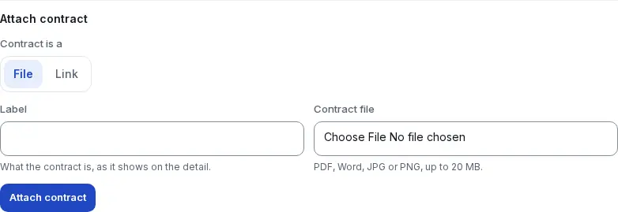

# Attaching a contract

Most vendors have one agreement on file that covers every detail. A detail can also have its own contract. Details missing a contract show on To-do.

1. Open the detail and choose **Manage this detail**. Under **Attach contract**, choose **File** or **Link**.
2. Give it a **Label**, which is how it shows on the detail.
3. Choose the **Contract file** (PDF, Word, JPG or PNG), or paste a link that starts with https://.
4. Choose **Attach contract**.

   

A vendor's own agreements are under **Contracts and documents** on the vendor's page: **Upload** or **Add link**, with an expiry date. Coordinators are reminded 60 and 30 days before a contract expires.
