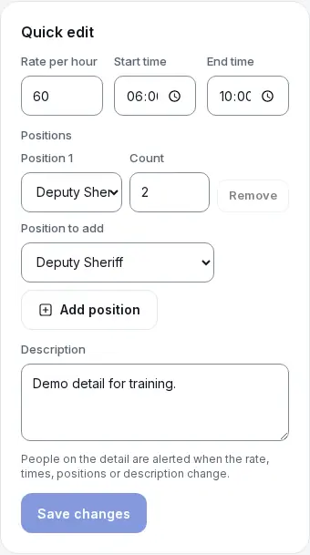
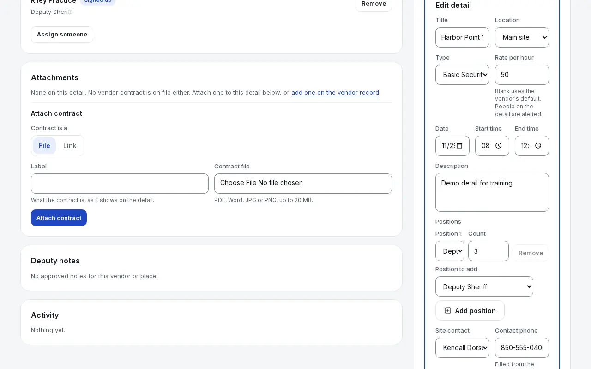
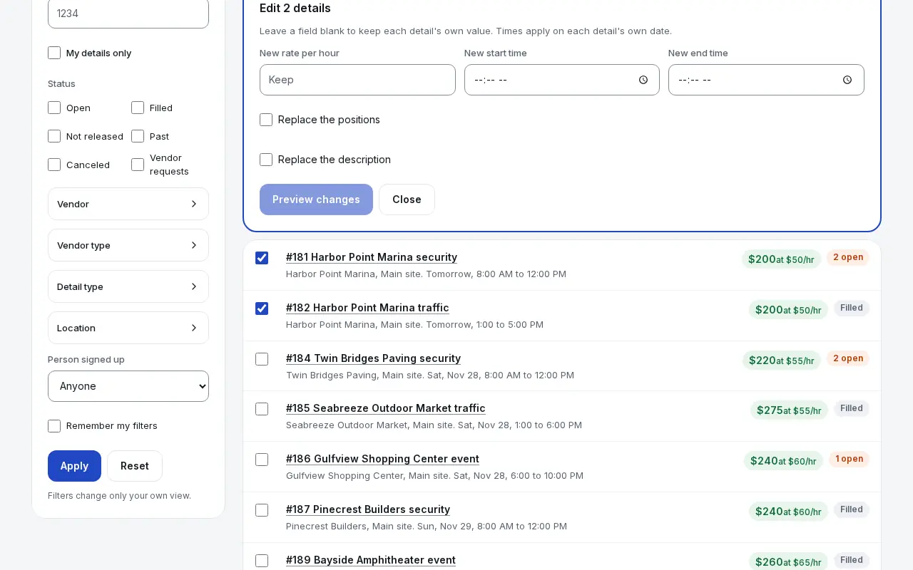

# Quick edit and bulk edit

## One detail

1. Open the detail and choose **Manage this detail**. **Quick edit** changes the **Rate per hour**, **Start time**, **End time**, positions and **Description**. Choose **Save changes**. Quick edit is for details that have not started.

   

2. For anything else, choose **Edit detail** under **Manage**. On a series, **Apply to** chooses this detail or this and the later ones.

   

## Many details at once

1. In **Details**, tick the box beside each detail, or **Select all shown that can change**.
2. Choose **Edit selected**. The panel says how many, such as **Edit 2 details**.
3. Fill only what should change: **New rate per hour**, **New start time** or **New end time**. Tick **Replace the positions** or **Replace the description** to change those. Leave a field blank to keep each detail's own value. Times apply on each detail's own date.
4. Choose **Preview changes** and check the before and after for each detail. Then save them all. Every detail saves, or none does. **Close** leaves without saving.

   

People on a detail are alerted when the rate, times, positions or description change.
