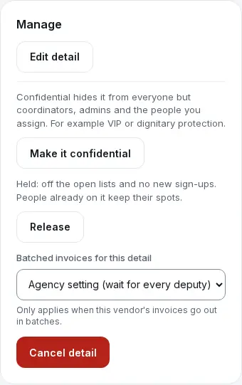

# Hold and Release

A held detail stays unreleased: deputies can see it is coming but cannot sign up.

1. Open the detail and choose **Manage this detail**. Under **Manage**, one button holds or releases it: **Hold** on a released detail, **Release** on a held one. A held detail is off the open lists and takes no new sign-ups. People already on it keep their spots.
2. On a series, choose whether it applies to this detail only or to this and the later ones.
3. If the detail's normal release time is still ahead, you choose: **Release at the normal time** waits for the agency's usual release day and time, and **Release now** opens it for sign-up straight away.

   

> Holding a detail pays and tells no one. It only stops new sign-ups until you release it. A vendor's payment hold is different; see [Vendors and payment holds](16-vendors-and-payment-holds.md). A confidential detail is never released, so it has no **Hold** or **Release**; see [Confidential details](35-confidential-details.md).
