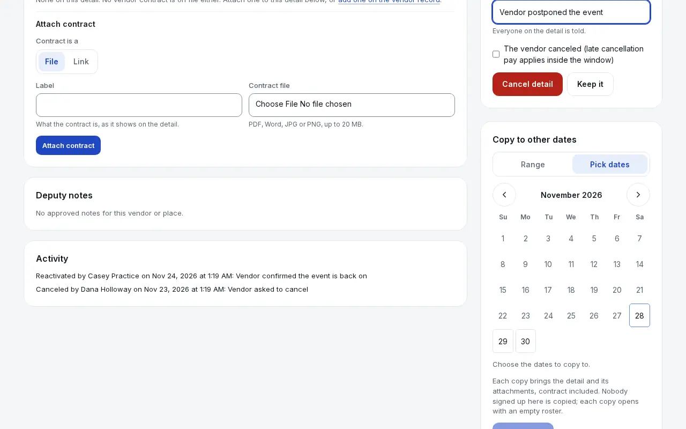
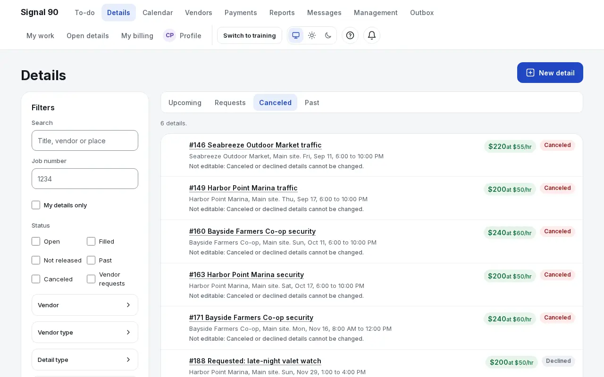
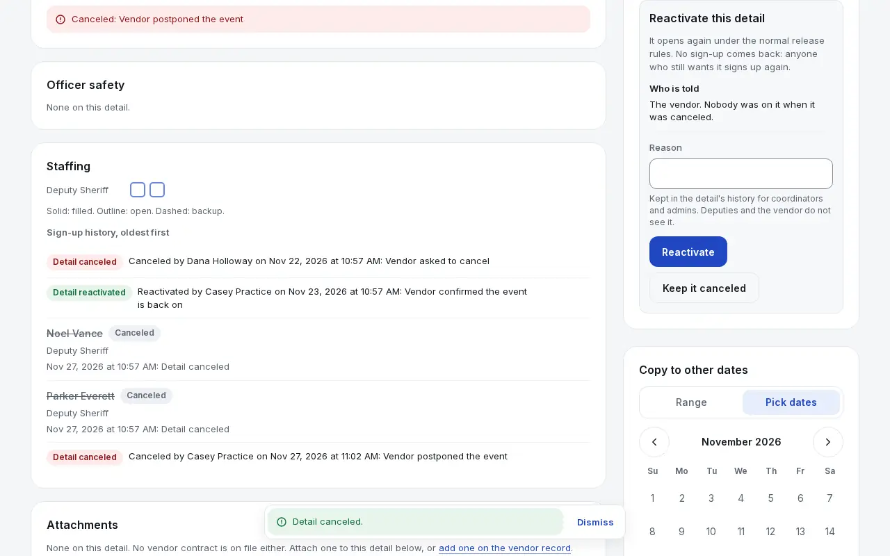

# Canceling and reactivating a detail

## Canceling

1. Open the detail, choose **Manage this detail**, then **Cancel detail**.
2. Type the **Reason**. Everyone on the detail is told. The vendor gets an email too, unless that alert is switched off.
3. If you are canceling for the vendor, tick **The vendor canceled (late cancellation pay applies inside the window)**. Inside the window (24 hours by default) the people on it are then paid the minimum.
4. Choose **Cancel detail** again to confirm.
5. To waive late cancellation pay afterwards, open the canceled detail, type a **Reason to waive late cancellation pay** and choose **Waive late cancellation pay**. The people are told.

   

Canceled details are under **Details**, **Canceled**.

## Reactivating

You can bring back a canceled detail before its end time.

1. Open it and choose **Reactivate detail**.
2. Read **Who is told**: the people who were on it and the vendor. Type the **Reason**. It is kept in the detail's history for coordinators and admins.
3. Confirm. The detail starts fresh, with an empty roster, under the normal release rules. Anyone who still wants it signs up again.

   

Any late-cancel pay not yet billed is canceled. Once late-cancel pay has been billed, which can happen only after the end time, the detail can no longer be reactivated.
