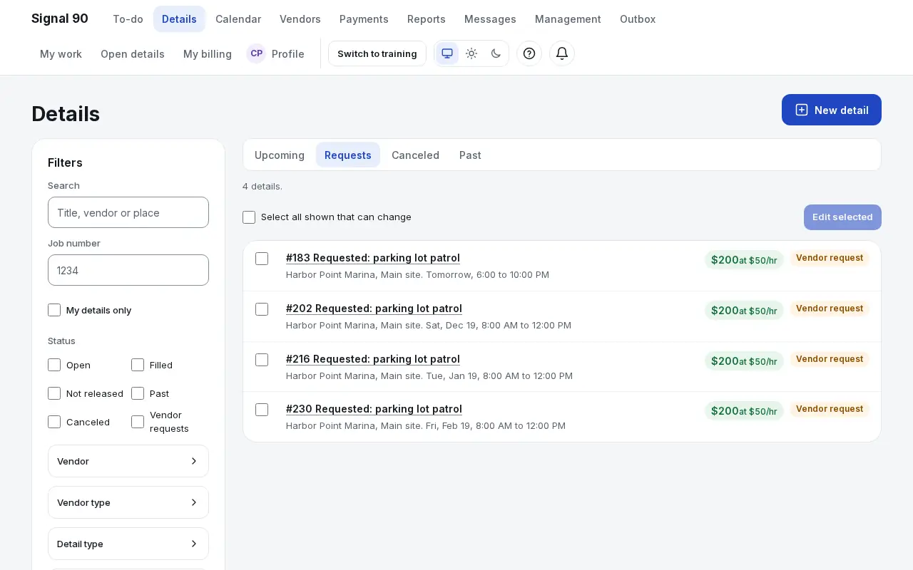
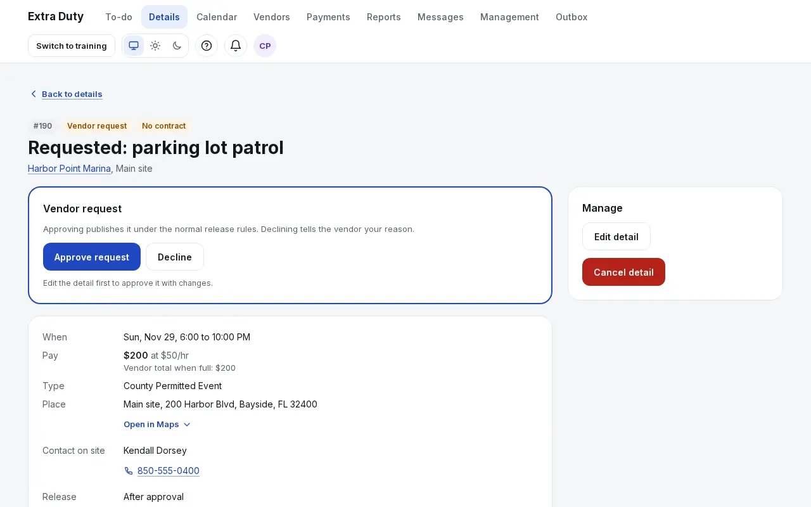

# Vendor requests

1. Open **Details** and choose **Requests**, or use **Vendor requests** on To-do.

   

2. Open a request. Check the date, positions, rate and description. Use **Edit detail** to fix anything first.
3. Choose **Approve request** to post it. It is released under the normal rules. Or choose **Decline** and give the vendor a reason.

   

A request for several dates is approved together. Vendors can change a request until you decide.
