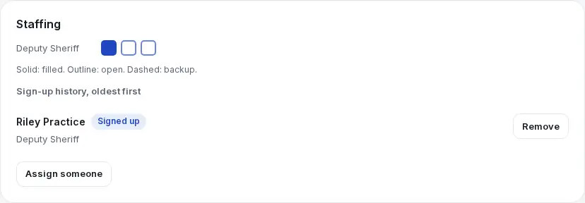

# Assigning and removing people

1. Open the detail and choose **Manage this detail**. **Staffing** shows the positions, the people on it and the sign-up history.
2. To add someone, choose **Assign someone**, pick the person and position, and choose **Assign**. If a rule is broken, the form lists it and you may override with a reason. See [Conflicts and overrides](09-conflicts-and-overrides.md).
3. To take someone off, choose **Remove** beside their name and give the reason. Their spot opens and backups are offered it.

   

The person gets **A coordinator assigns you** or **A coordinator removes you**.

## Offered spots

Deputies cannot drop a detail. They give the spot away and stay on it, responsible, until someone takes it over. Their row shows an **Offered** chip, and the spot is open to backups first, then to anyone eligible. On an offered row you can:

- **Assign a replacement**: pick the person. They are assigned under the usual rules (a broken rule needs an override reason) and replace the deputy. Both are told.
- **Cancel the offer**: the deputy keeps the spot and is told.
- **Remove**: take the deputy off outright, with a reason. It counts as **Removed by coordinator**.

Each of these is audited. An offered spot nobody has taken inside the late cancellation window (Management, Settings) shows on To-do as **Offered spot not taken**, with the deputy, the detail number and the date, and the deputy gets a reminder. Nothing is removed automatically. A confidential detail is never offered, so for one of those, remove the deputy and assign someone yourself.
