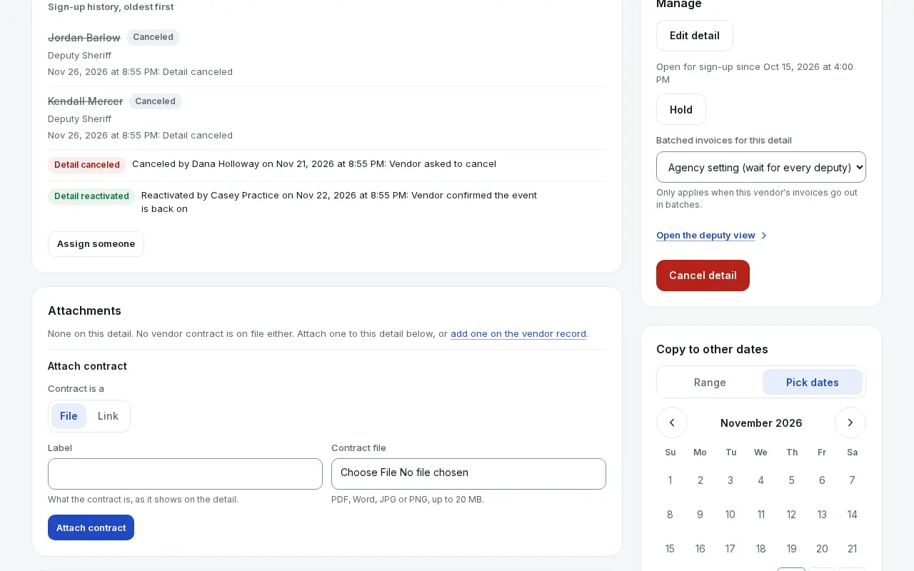

# Sign-up history on a detail

Coordinators and admins see every sign-up on a detail, including canceled ones: who, when and why.

1. Open the detail, choose **Manage this detail** and find **Sign-up history, oldest first** under **Staffing**.
2. Each line shows the person, the position, the status (such as **Canceled** or **Signed up**) and when and why it changed. Cancels and reactivations of the whole detail show too.
3. A spot given away shows its offers under the person: "Offered by Carmen Caldwell on Dec 1" with the reason, then **Taken over by** the new person, **Offer withdrawn** or **Offer canceled by** the coordinator. A sign-up someone took over ends as **Gave away**. Sign-ups canceled before giving away replaced canceling (Nov 27, 2026) stay canceled.

   

Deputies see only the current roster. Vendors see names only once every spot is filled.
