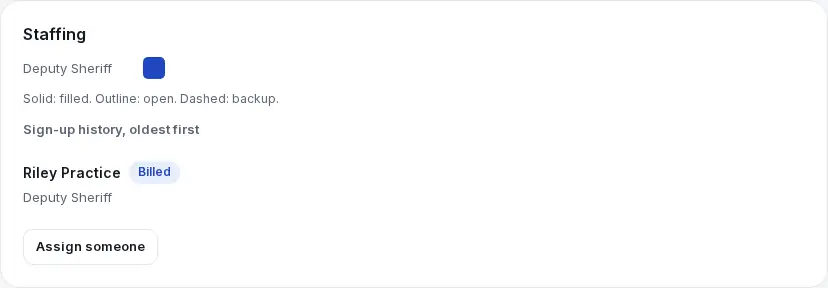
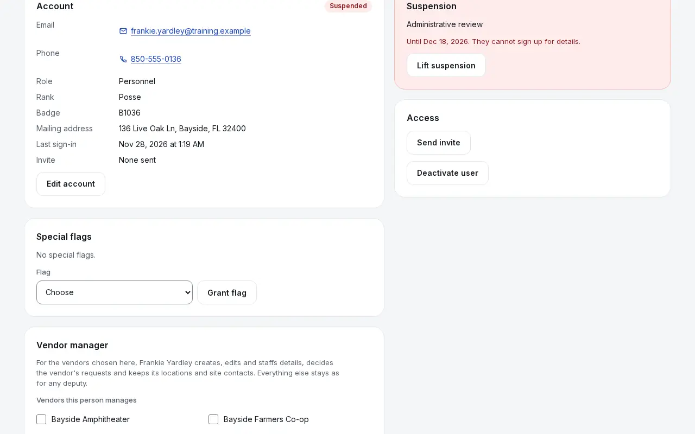

# No-shows and suspensions

## Marking a no-show

1. After the detail, open it and find the person under **Staffing**.
2. Choose **Mark no-show** and add a note. A no-show counts in the personnel activity report.

   

## Suspending someone

1. Open **Management**, **Users**, and the person.
2. Under **Suspension**, give the **Reason** and, if it has an end, **Suspended until**. Tick **Remove them from details they signed up for** to open their spots.
3. Save. A suspended person cannot sign up. **Lift suspension** ends it early.

   

> A suspension is a personnel matter. Only coordinators and admins ever see "Removed by suspension". The deputy sees a plain "Canceled", vendors see no reason, and no alert or email mentions a suspension.
