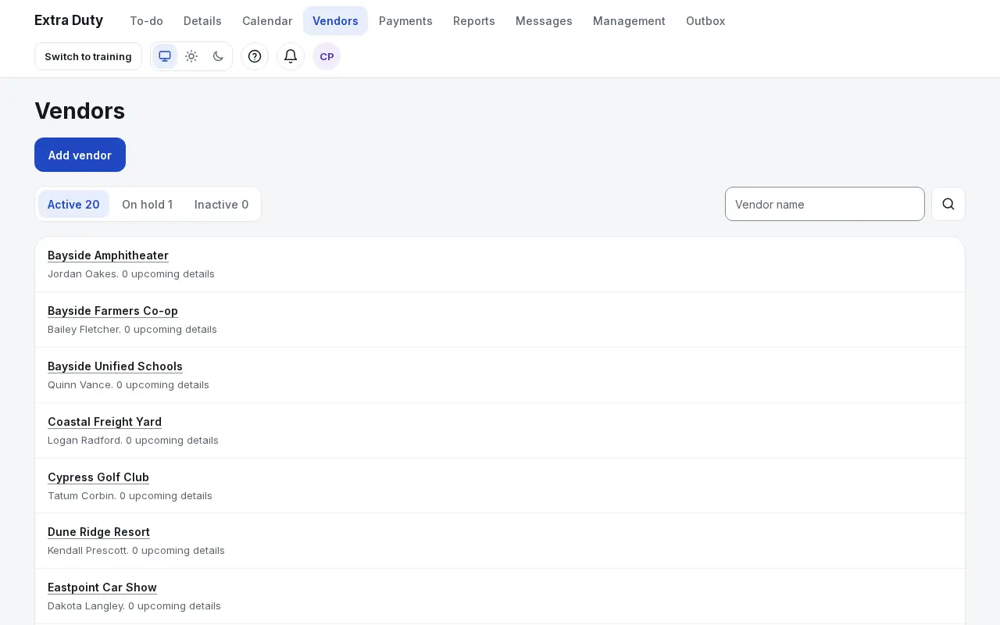
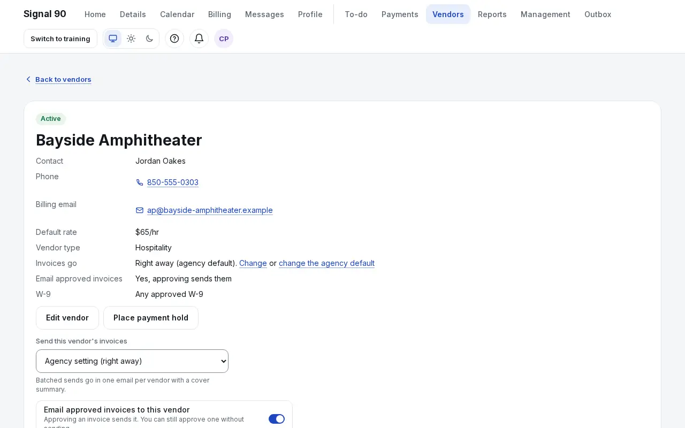

# Vendors and payment holds

1. Open **Vendors**. Tabs show **Active**, **On hold** and **Inactive** vendors. Choose **Add vendor** for a new one.

   

2. Open a vendor. The record shows one field per line: contact, phone, billing emails, default rate and type. Choose **Edit vendor** to change them.
3. **Send this vendor's invoices** sets this vendor's schedule, or follows the agency setting. **Email approved invoices to this vendor** decides whether this vendor's invoices are emailed. When it is off, **Approve, don't send** is the first choice at review, and an invoice that skips review is approved but kept back too, until someone chooses **Send now**. See [Invoice review](18-invoice-review.md).
4. **Place payment hold** stops new work for a vendor that does not pay. Give the reason. Future details lock and the people on them are told. **Resolve payment hold** ends it.
5. To cancel a detail locked by a payment hold, choose **Cancel detail** on it. If the hold was placed inside the late cancellation window, the form says the people signed up are paid the minimum. Otherwise you can tick **Pay the people signed up the late cancellation minimum**.

   

The same page has the vendor's locations, site contacts, **Contracts and documents**, **Deputy notes**, **Restricted deputies** (coordinators only; nobody is told the reason) and **Vendor logins** (**Add login** sends an invite).
