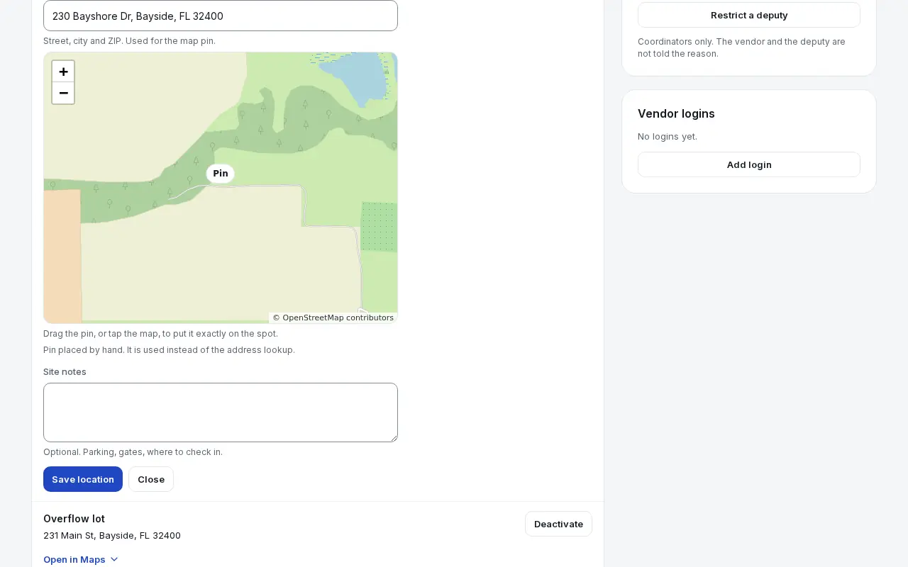

# Locations and map pins

1. Open the vendor. Under **Locations**, choose **Add location** or **Edit** on a location.
2. Enter the name and the street, city and ZIP. See [Entering addresses](05-address-field.md).
3. Drag the pin, or tap the map, to put it exactly where deputies should go. Add **Site notes**, such as parking or which gate.
4. Choose **Save location**. **Deactivate** retires a site; it stays on details that used it.

   
