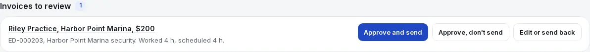
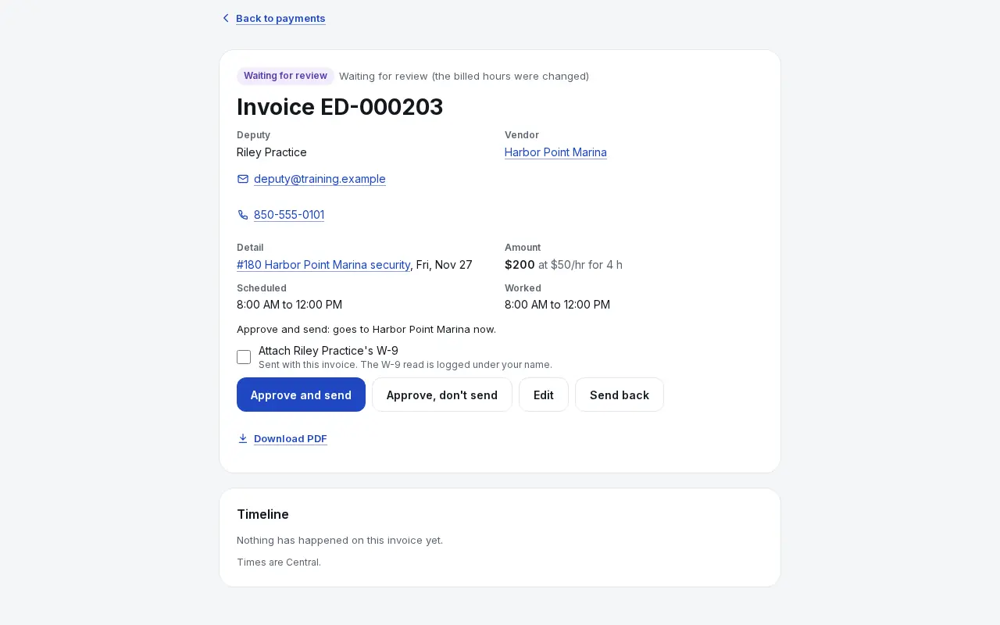
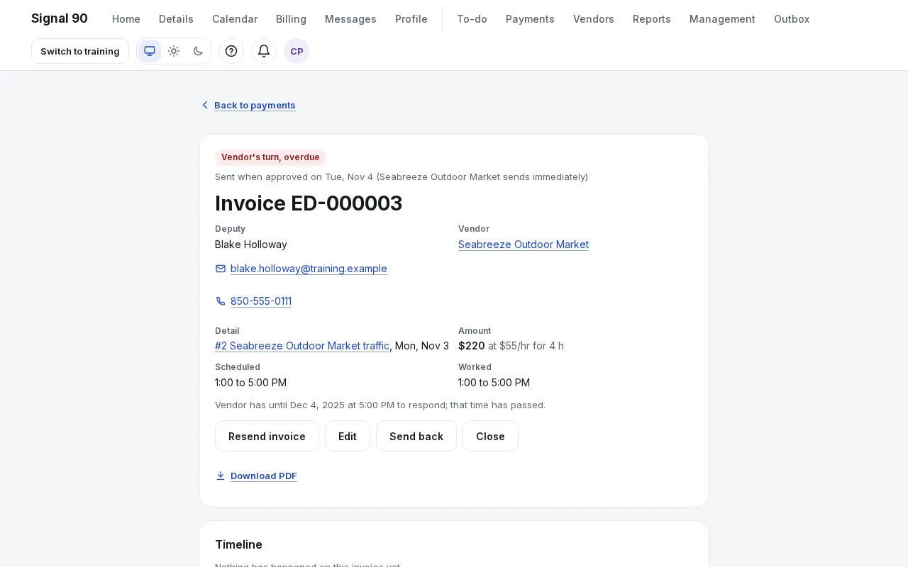

# Reviewing invoices

Which invoices come to a coordinator depends on the **Invoice review** setting (see [Settings](25-settings.md)). By default only invoices whose hours the deputy changed wait for review; an invoice billed at the scheduled hours goes to the vendor without one. Nothing in review reaches the vendor until it is approved and sent.

1. On **To-do**, **Invoices to review** lists them. You can act from the row.

   

2. Open the invoice to check the hours, rate and total against the detail.
3. Choose one:
   - **Approve and send**: approves it and emails it to the vendor. When the vendor is batched, the button reads **Approve for the next send** and the invoice waits for the batch.
   - **Approve, don't send**: approves it but keeps it back. The vendor cannot see it until it is sent.
   - **Edit**: change the worked times, rate or minimum hours for this invoice, with a reason. The vendor gets a revised invoice with the same number.
   - **Send back**: return it to the deputy with a comment.

   

   Each vendor's **Email approved invoices to this vendor** switch decides which choice comes first. You can still pick either one each time.

4. Later, on a sent invoice:
   - **Send now** sends an approved invoice that was kept back (**Send now, with the next batch** when the vendor is batched).
   - **Send paid invoice** sends an invoice paid on the spot, marked Paid with $0.00 due (**Send paid invoice with the next batch** when batched).
   - **Resend invoice** sends it again. **Also send to** adds one extra email address for this resend only. The W-9 never goes to that extra address.
   - **Download PDF** saves a copy.

   

> A coordinator may handle their own invoices. Every action is logged.
