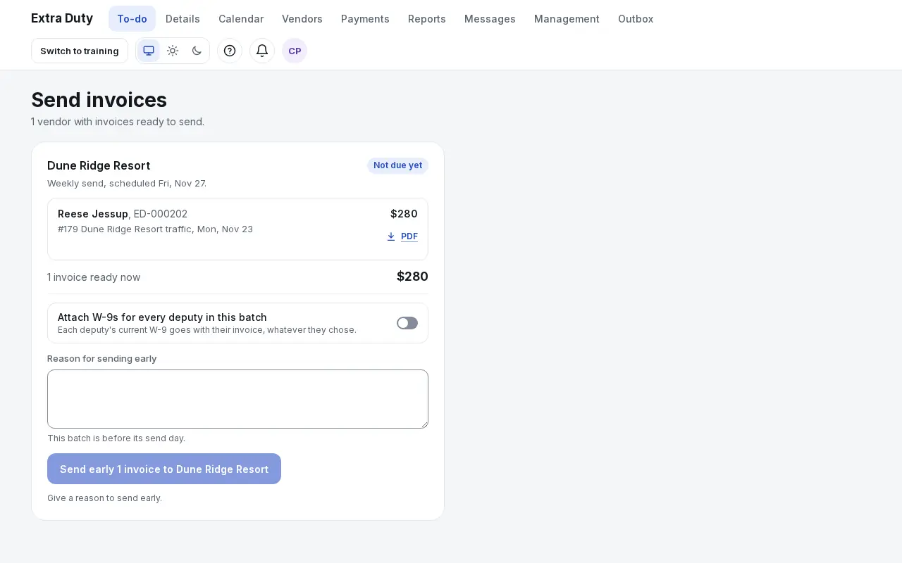

# Batches and the Send invoices page

Invoices can go out right away, or in a batch weekly, every two weeks or monthly. Each vendor can have its own schedule.

1. Set the agency's schedule in **Management**, **Billing and invoices** (**Send approved invoices** and the send days). For one vendor, open the vendor and pick **Send this vendor's invoices**. The top of the vendor's record shows **Invoices go** (marked **agency default** when the vendor has no schedule of its own) and **Email approved invoices**, with a **Change** link. **Payments** shows each vendor's schedule under its name.

   

2. Open **Payments** and choose **Send invoices**. Each vendor with invoices ready shows its schedule, the invoices and the total. When nothing is queued, the page says which vendors are on a batched schedule, with links to **Billing settings** and to each vendor.
3. Tick **Attach W-9s for every deputy in this batch** to send each deputy's approved W-9 with their invoice. A W-9 waiting for review, rejected, or (for a vendor that needs one signed this year) signed in an earlier year never goes; **No W-9 that can go** names those deputies.
4. On the send day, batches go out by themselves. To send before the day, type a **Reason for sending early** and choose **Send early**.

   

Each batch goes in one email with a cover sheet that lists every invoice and the grand total. An invoice paid on the spot adds $0.00 to the total. Sending cannot be undone; the vendor's time to pay starts then.
