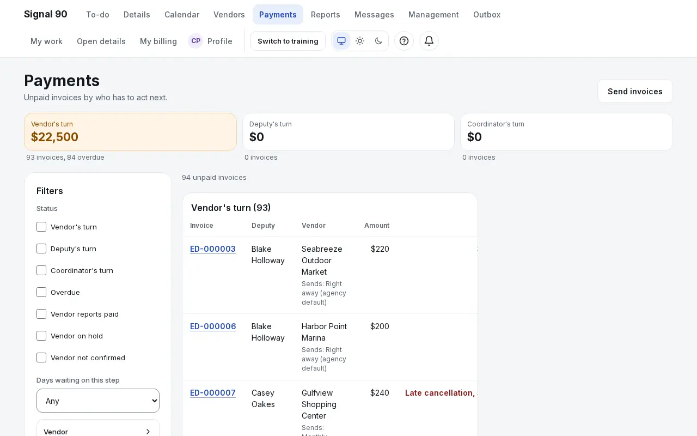
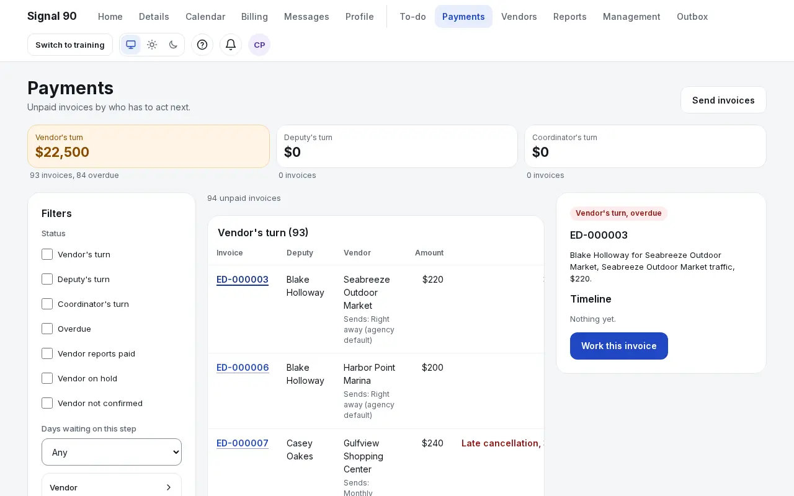

# Payments and payment issues

Every unpaid invoice is someone's turn: the vendor's, the deputy's or a coordinator's, until both the deputy and the vendor mark it paid.

1. Open **Payments**. The top shows the **Vendor's turn**, **Deputy's turn** and **Coordinator's turn** totals. Filter by **All**, **Overdue**, **Vendor reports paid** or **Vendor on hold**.

   

2. Choose an invoice number to open its timeline and actions.

   

3. When a deputy reports non-payment, an issue opens. Add a note and set **Waiting on** to the person who must act next. Notes are optional; note presets fill in common text.
4. To finish it, choose **Resolve issue** and pick the **Outcome**: **Paid**, **Resolved, the invoice continues** or **Written off**. The button then reads **Resolve issue**, **Close as paid** or **Write off** to match.

Overdue vendors can be put on a payment hold. See [Vendors and payment holds](16-vendors-and-payment-holds.md).
