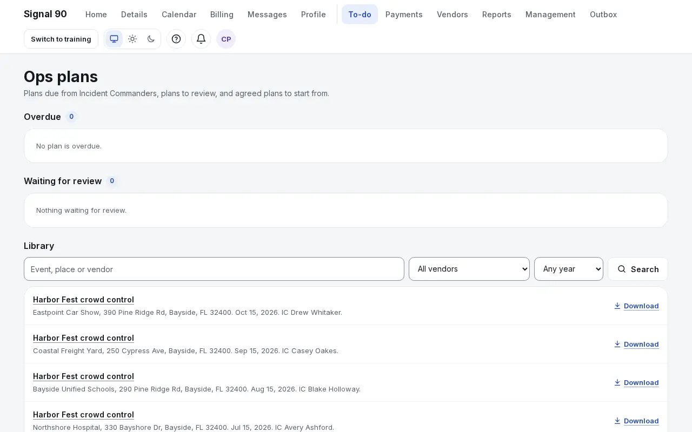

# Ops plan review and the library

1. Open **Reports** or **To-do** and go to **Ops plans**. **Overdue** and **Waiting for review** list the plans that need you.
2. Open a plan, read it, and agree or deny it. A denial needs a reason; the Incident Commander then submits a new version.
3. The **Library** keeps every agreed plan. Search by event, place or vendor and year, and choose **Download**. Use last year's plan as a starting point.

   

When plans are due and who reviews them are set in **Management**, **Ops plan review**.
