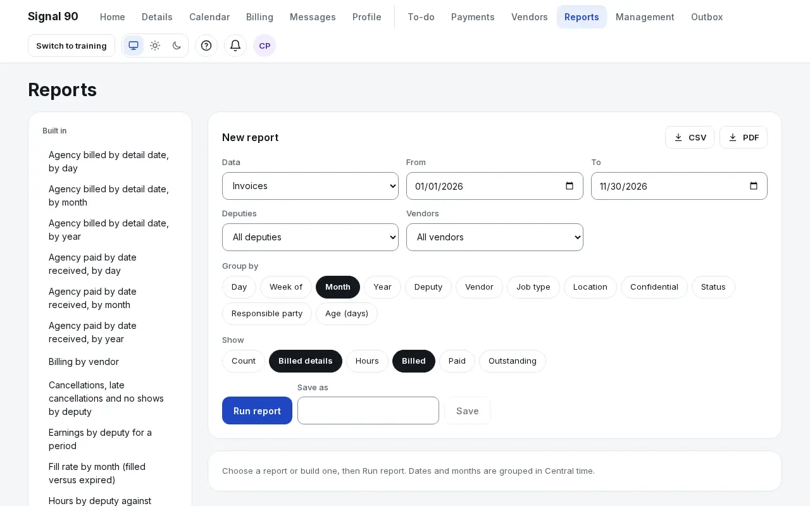

# Reports and exports

1. Open **Reports**. **Built in** lists ready-made reports, such as billing by month, payments by vendor, cancellations and hours by deputy.
2. Or build a **New report**: choose the data, the dates, the deputies and vendors, how to **Group by** and what to **Show**.
3. Choose **Run report**. Give it a name and choose **Save** to keep it.
4. Choose **CSV** or **PDF** to download it.

   

Dates and months are grouped in Central time.
