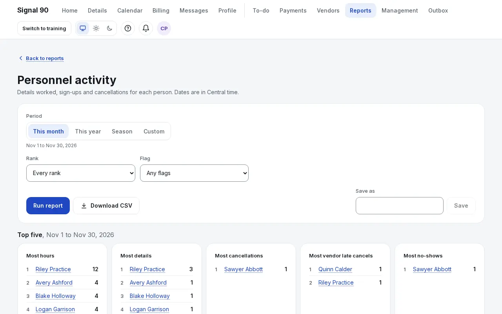

# The personnel activity report

This report shows who works the most and who cancels the most. Coordinators and admins only.

1. Open **Reports** and choose **Personnel activity**.
2. Pick the **Period**: **This month**, **This year**, **Season** or **Custom**. Filter by **Rank** or **Flag**. Choose **Run report**.
3. **Top five** shows most hours, most details and most cancellations. The table lists each person.
4. Choose **Download CSV** to keep it.

   

## How cancellations count

Cancellations are split into **Gave away**, **Removed by coordinator**, **Removed by suspension**, **No-show** and **Vendor late cancel**. Only Gave away, Removed by coordinator and No-show count toward the total. A vendor's late cancel or a suspension removal never counts against the deputy.
