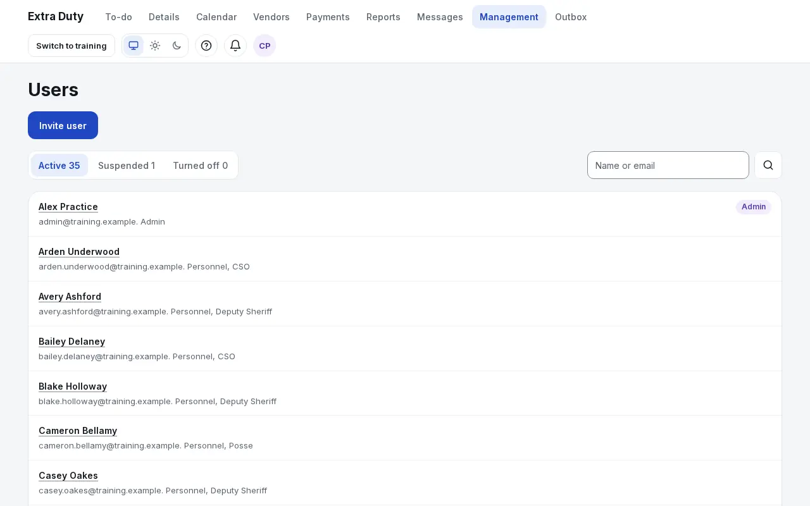
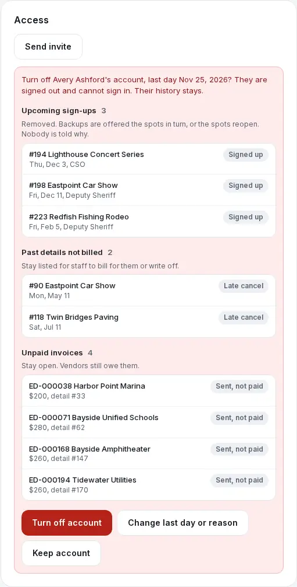
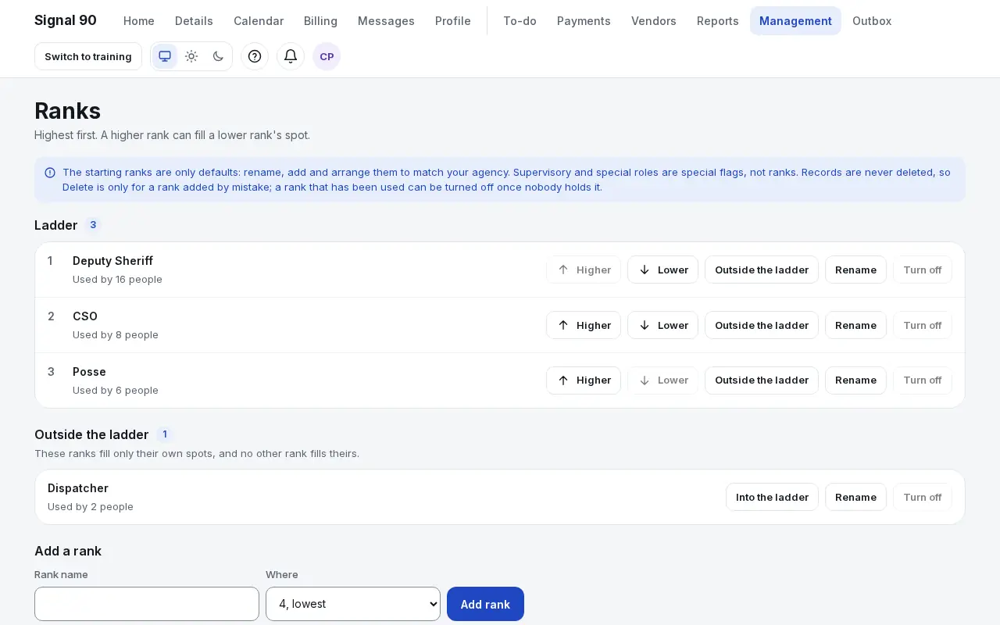

# Users and ranks

## Users

1. Open **Management**, then **Users**. Tabs show **Active**, **Suspended** and **Turned off** accounts.
2. Choose **Invite user**. Enter the name, email, phone, **Role** (Personnel, Coordinator or Admin), **Rank** and **Badge number**. Choose **Send invite**. The link to set a password works for 7 days.

   

3. Open a person to edit them, grant **Special flags** (such as Incident Commander), choose the vendors a deputy manages (see [Vendor managers](34-vendor-managers.md)), review or upload their **W-9** (see [W-9 review and requests](32-w9-review-and-requests.md)), **Resend invite**, suspend them, or **Deactivate user**. Only admins can change admin accounts. Nothing is deleted; history stays.

## When someone leaves

1. On the person's page, under **Access**, choose **Deactivate user**.
2. Enter their **Last day** (today or earlier) and a **Reason**. The reason is for staff only and goes in the audit log. Choose **Review checklist**. Nothing changes yet.
3. The checklist shows:
   - **Upcoming sign-ups**: every detail after the last day, not yet started, that they are signed up for, a backup on, or waiting on a shorter shift. These are removed. A detail they already worked or are working now stays, even after a backdated last day. A backup is offered each spot in turn, or the spot reopens under the normal rules. Vendors and other deputies are never told why, and the person gets no alert.
   - **Past details not billed**: work that is ready to bill and has no invoice, late-cancel pay included. These stay listed for staff.
   - **Unpaid invoices**: invoices not yet paid or closed, with the status and amount. They stay open, because the vendor still owes the person.

   

4. Choose **Turn off account**. An admin with API keys sees the keys that will stop working and must tick the box first. You cannot turn off your own account or the last active admin.

After that, the person's page reads "Deactivated on (date) by (name): (reason). Last day (date)." and lists what is left:

- **Not billed yet**: choose **Bill for them** to bill the detail on their behalf, or **Write off** with a reason. The same list is on the **To-do** page under **Left the agency: not billed**.
- **Unpaid invoices**: open one to follow the payment as usual.

In the personnel activity report, a sign-up removed this way shows under **Left the agency**. It is not a removal by a coordinator and not a cancellation.

The annual access review's **Turn off** decision uses the same flow: it asks for the last day, and the reason is "Access review".

## Reactivating

On a turned-off person's page, choose **Reactivate**, enter a reason and choose **Reactivate account**. Old sign-ups are not restored. Calendar feeds and API keys stay revoked, so the person makes new ones. They sign in with their password, or with **Forgot password** if they no longer have it.

## Ranks

The starting ranks are only defaults. Rename, add and arrange them to match your agency.

1. Open **Management**, then **Ranks**. The **Ladder** runs highest first: place 1 is the highest rank. A higher rank can fill a lower rank's spot.
2. Use **Higher** and **Lower** to move a rank up or down the ladder, and **Rename** to change its name in place.
3. **Outside the ladder** lists ranks that fill only their own spots, such as Dispatcher. No other rank fills theirs. Choose **Outside the ladder** on a ladder rank to move it there, or **Into the ladder** on a rank outside it and pick its place.
4. To add a rank, enter its name under **Add a rank**, choose **Where** (a place in the ladder, or **Outside the ladder**) and choose **Add rank**.
5. Moving, adding or taking a rank out of the ladder can change who may fill each position type. When it does, the page lists each change first, for example "Deputy Sheriff spots: CSO can now fill them. This applies to 4 upcoming details already posted." Choose **Make the change** or **Cancel**. People already signed up keep their spots, and a detail with its own rank choices is not changed.

   

### Delete and turn off

Records are never deleted, so **Delete** is only for a rank added by mistake. It shows only on a rank nothing has used: nobody holds or has held it, and no position type, setting, saved report or past record refers to it.

A rank that has been used shows **Turn off** instead, with the reason, such as "Used by 3 people" or "Used in past records". A rank someone holds cannot be turned off until everyone on it moves to another rank. A turned-off rank can be turned back on.

Position types work the same way under **Management**, **Position types**: **Edit** renames one or changes who fills it, **Add position type** adds one, **Turn off** takes it off new details, and **Delete** shows only for a type no detail or record has used.

Every change is kept in the audit log. Supervisory and special roles are special flags, not ranks.
