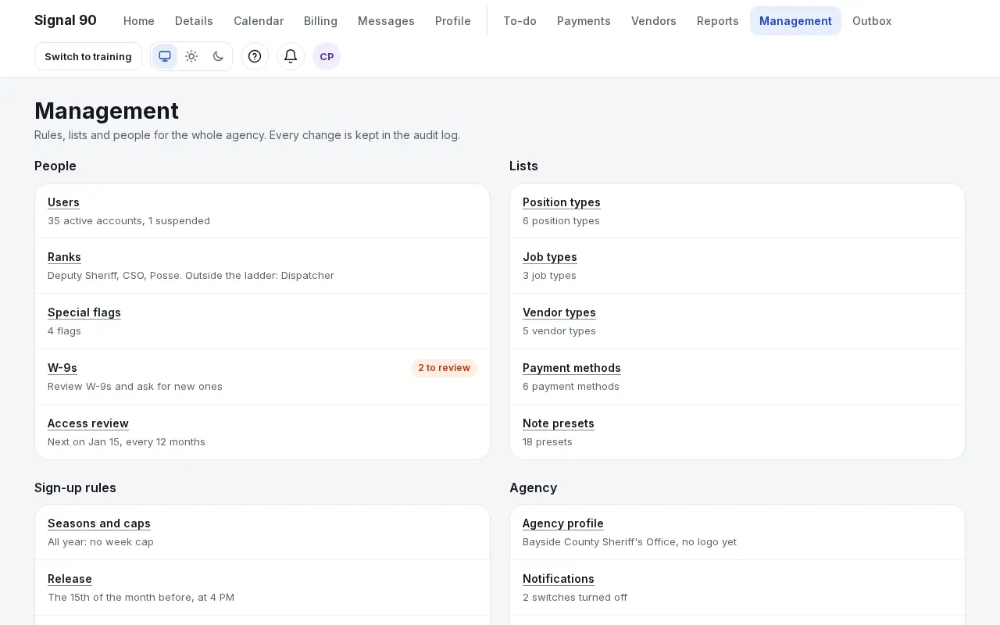
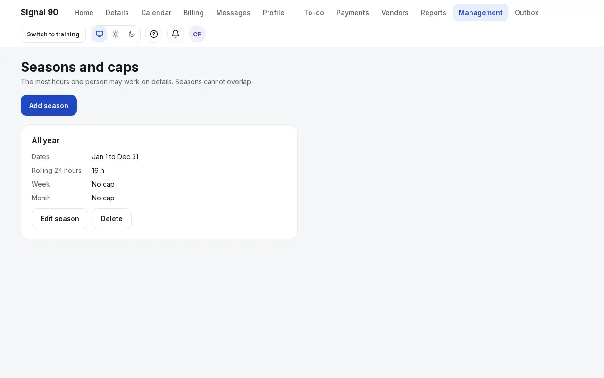
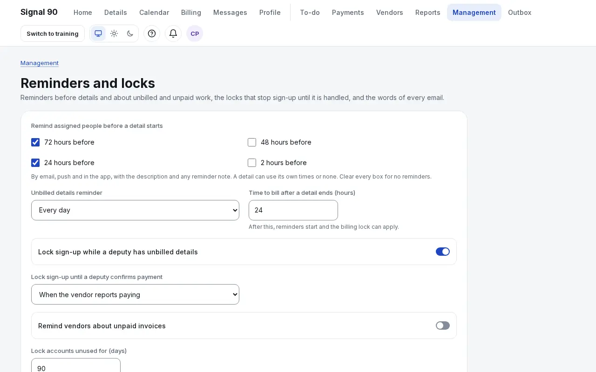

# Settings

The agency's rules are settings, so changing one needs no programmer. Every change is kept in the audit log.

1. Open **Management**. The sections are:
   - **People**: **Users**, **Ranks**, **Special flags** and **Access review**.
   - **Sign-up rules**: **Seasons and caps**, **Release** (the monthly release day and time), **Sign-up**, **Vendor limits** and **Ops plan review**.
   - **Billing**: **Billing and invoices** and **Reminders and locks**.
   - **Lists**: **Position types**, **Job types**, **Vendor types**, **Payment methods** and **Note presets**.
   - **Agency**: **Agency profile** and **Notifications**.

   

2. Open a section, change the values and save. Each field says what it does.
3. **Seasons and caps** sets the hour caps: any 24 hours, the week and the month, per season. Seasons cannot overlap.

   

## Detail reminders

**Management**, **Reminders and locks**, **Remind assigned people before a detail starts** sets when the people on a detail are reminded: any of 72, 48, 24 and 2 hours before the start (72 and 24 by default). Clear every box for no reminders. Each reminder goes by email and push, following the agency's switches for **Detail reminder** under **Notifications** and each person's own choices, and always to the in-app inbox.

- The email has the detail number and title, the vendor, the date and time, the location with an **Open in Maps** link, the person's position and pay, the description, the reminder note, the officer safety notes, the site contact and a link to the detail.
- It goes to everyone on the detail when the reminder time comes, a deputy who has offered their spot included. Backups do not get it. Someone assigned after a reminder went out gets only the later ones.
- If the detail's time changes, the reminders still to come move with it. Canceled and held details get none.
- A confidential detail's email and push say only "Reminder: you are assigned to a confidential detail on <date> at <time>." The app shows the full reminder.

A detail can use its own times or none, and add a note. See [Creating a detail](02-creating-details.md). The reminder's wording is the **Detail reminder** message under **Email messages** on the same page. See [Email messages](36-email-messages.md). Changes to this setting are kept in the audit log.

## Invoice review

**Management**, **Billing and invoices**, **Invoice review** decides which invoices wait for a coordinator:

- **Send every invoice right away**: no invoice waits for review.
- **Review invoices whose hours changed** (the default): only invoices where the deputy changed the worked hours wait. The deputy's button reads **Submit for review** instead of **Send invoice**.
- **Review every invoice**: every invoice waits on To-do under **Invoices to review**.

An invoice that does not wait for review still follows the vendor's settings:

- If the vendor's **Email approved invoices to this vendor** switch is off, it is approved but not sent, and stays hidden from the vendor until someone chooses **Send now**.
- If the vendor's invoices go out in batches (**Send approved invoices**, or the vendor's own **Send this vendor's invoices**), it waits for the next batch on the Send invoices page.
- Otherwise it is emailed to the vendor straight away.

For an invoice that is reviewed, the coordinator decides: **Approve and send** or **Approve, don't send**. The vendor's **Email approved invoices to this vendor** switch only decides which of the two is offered first. If the vendor is batched, **Approve and send** becomes **Approve for the next send**, and the invoice waits for the batch. See [Reviewing invoices](18-invoice-review.md) and [Batches and the Send invoices page](19-sending-invoices.md).

The email server and security settings are for admins only. See [Email server and security](31-email-server-and-security.md).
