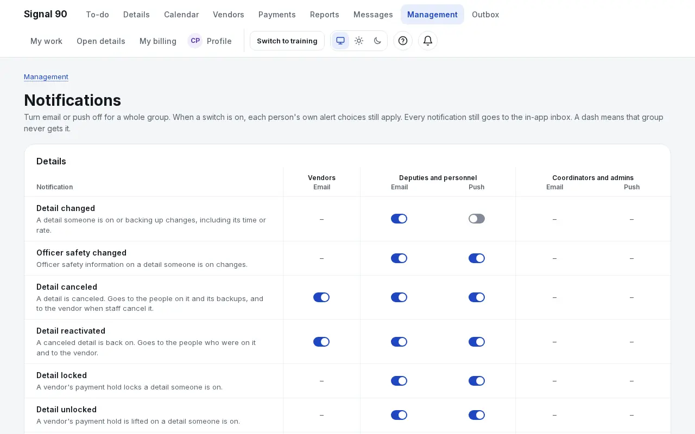

# Agency notification settings

Switch Email and Push on or off for each kind of alert and each group: vendors, deputies and personnel, and coordinators and admins.

1. Open **Management**, then **Notifications**.
2. Each row is one kind of alert, such as **Detail changed** or **Detail canceled**. Turn the switch for a group's Email or Push on or off. A dash means that group never gets that alert.

   

3. Changes save as you go.

## What people see

- When a switch is on, each person's own alert choices still apply.
- When a switch is off, their Profile shows that box greyed out with **Turned off by your agency**.
- The in-app inbox always keeps a record.
- Sign-in codes, invites, password resets and the invoice email itself are always on.

To change what an email says, rather than whether it goes, see [Email messages](36-email-messages.md).
