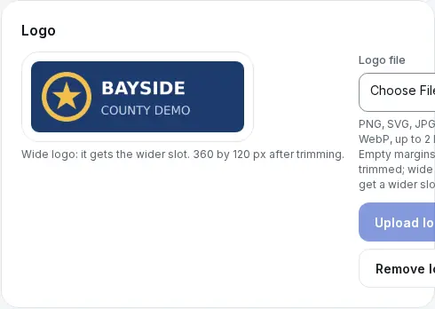
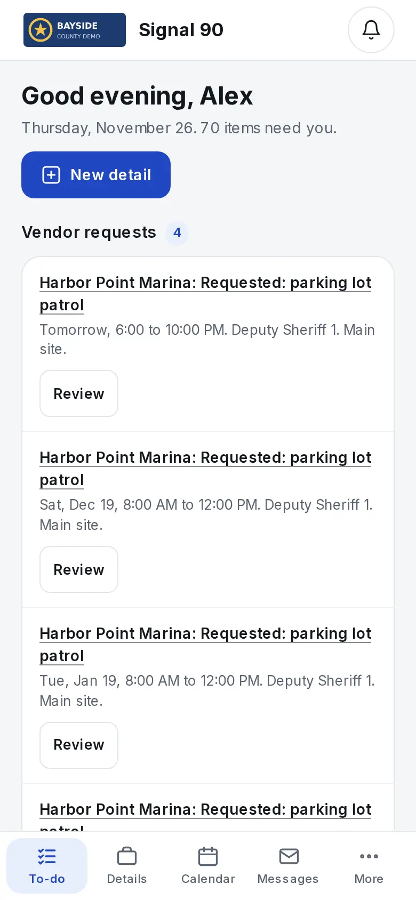

# The agency logo

The logo shows at sign-in, in the top bar and on every invoice and PDF.

1. Open **Management**, then **Agency profile**. Check the agency name, Sheriff's name and contact lines, which print on invoices. Choose **Save agency profile**.
2. Under **Logo**, choose the **Logo file**: PNG, SVG, JPG or WebP, up to 2 MB. Choose **Upload logo**.

   

3. The logo appears in the top bar, 40 pixels tall, beside the agency name.

   

   

## How logos display

- Empty margins are trimmed. A logo is never cropped or stretched.
- A wide logo (about 1.3 to 1 or wider) gets a wider slot.
- In night mode, a light plate sits behind a logo with no transparent background. A logo with a transparent background sits straight on the dark bar.
- White artwork can disappear on the white day header. Use a logo with color, or one on its own background.
