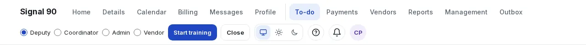
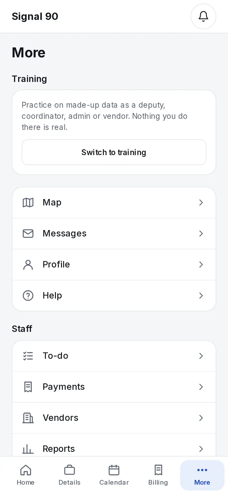
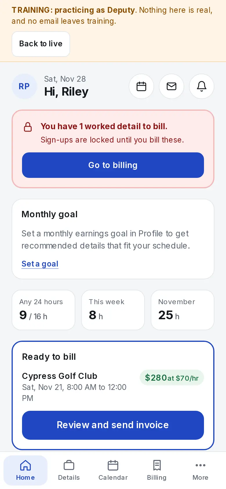

# Training mode

Training mode lets you practice on made-up data as a deputy, coordinator, admin or vendor. Nothing you do there is real, and no email leaves training.

1. On a computer, choose **Switch to training** in the top bar. On a phone, open **More** and find **Training**.

   

   

2. Pick the role to practice as and choose **Start training**.
3. Every page now shows the banner **TRAINING: practicing as** and the role. PDFs are marked TRAINING too.

   

4. Choose **Back to live** in the banner to return to real data.

## Resetting training

Training data goes back to the starting demo data every night. To reset it now, open the **Outbox** while in training and choose **Reset training data**. This affects everyone practicing.

> Training is a good place to try a feature before you use it for real, or to show a new deputy around.
