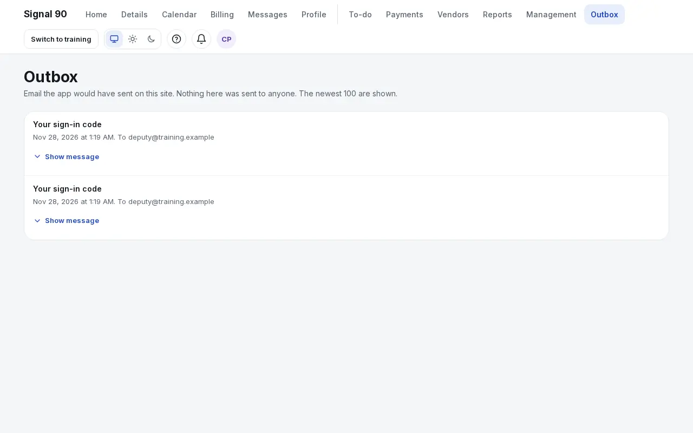

# The email outbox

In training mode, and on the staging site, Extra Duty keeps email instead of sending it. The **Outbox** shows what would have gone out.

1. Open **Outbox** (under **More** on a phone).
2. Each message shows when, who it was for, the subject and any attachments. Choose **Show message** to read it.

   

Nothing in the Outbox was sent to anyone. On the live site, the Outbox is not shown and email is sent normally.
