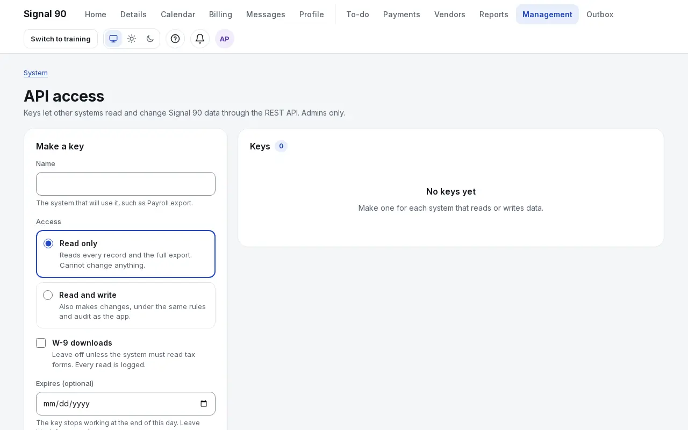

# API keys and data export (admins)

Keys let other systems, such as payroll, read and change Signal 90 data through the REST API.

1. Open **Management**, **System**, then **API access**.
2. Under **Make a key**, give it a **Name** (the system that will use it). Choose **Read only** or **Read and write**. Tick **W-9 downloads** only if the system must read tax forms. Set **Expires** if you want.
3. Choose **Make key**. Copy the key now. It is shown only once.

   

4. **Keys** lists each key with its last use. Turn a key off when it is no longer needed.
5. **API reference** lists every route. **Download the OpenAPI document** for developers.

## Data export

The full export is `GET /api/v1/export?format=json` (or `csv`) with an admin key. It includes every table except passwords and security tokens. Single tables are at `GET /api/v1/data/{table}`.

## Before you turn off an admin

Keys belong to the admin who made them. When you choose **Deactivate user** on an admin with active keys, a warning lists the keys that will stop working. Tick **I understand these keys will stop working** before **Turn off account**. Make new keys under another admin first if a system still needs them.
