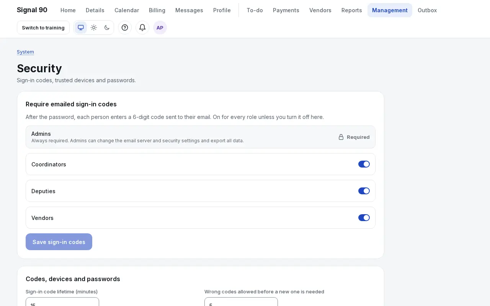

# Email server and security (admins)

These pages are for admins only. Coordinators cannot open them.

1. Open **Management** and choose **System**. It links to **Email**, **Security** and **API access**.

   

2. **Email** sets the mail server Extra Duty sends from. Choose the **Provider** and fill in the server details, then send a **Test email** after any change.
3. **Security** sets sign-in rules, such as how long a sign-in code lasts and how long a trusted device stays signed in.

   

Installing, backups, updates, restore, key rotation and the first mail server are covered in the operations and self-hosting guides that come with Extra Duty. They are written for the person who runs the server; ask them if you need one of those tasks.
