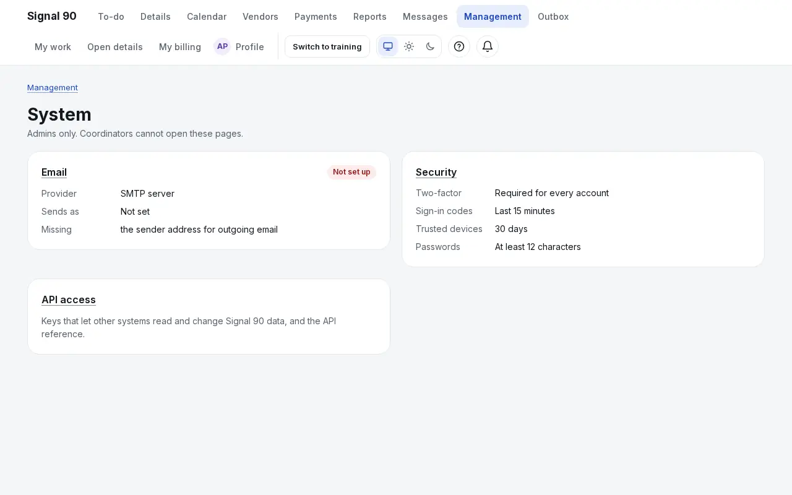

# Email server and security (admins)

These pages are for admins only. Coordinators cannot open them.

1. Open **Management** and choose **System**. It links to **Email**, **Security** and **API access**.

   

2. **Email** sets the mail server Signal 90 sends from. Choose the **Provider** and fill in the server details, then send a **Test email** after any change.
3. **Security** sets sign-in rules, such as how long a sign-in code lasts and how long a trusted device stays signed in.
4. Under **Require emailed sign-in codes**, each role has a switch: **Coordinators**, **Deputies** and **Vendors**. All are on to start. **Admins** always need a code and cannot be switched off, because admins can change the email server and security settings and export all data. To turn a role off, switch it off and choose **Save sign-in codes**. A warning explains that the site holds W-9s with Social Security numbers and pay records; choose **Turn off codes** to confirm or **Keep codes on**. The change applies at each person's next sign-in, people already signed in stay signed in, and it is recorded in the audit log. A person who signs in without a code stays signed in for 12 hours at most.

   

Installing, backups, updates, restore, key rotation and the first mail server are covered in the operations and self-hosting guides that come with Signal 90. They are written for the person who runs the server; ask them if you need one of those tasks.
