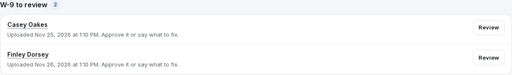
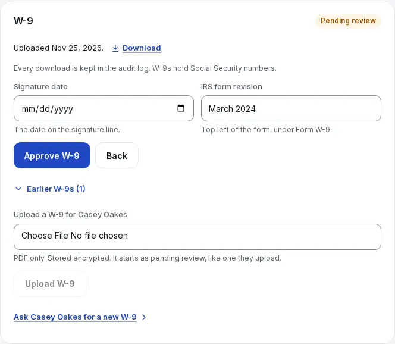
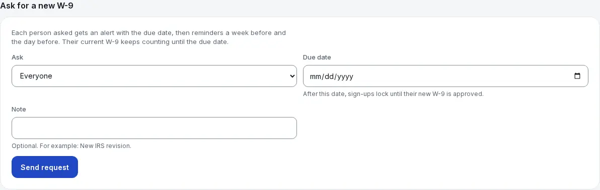

# W-9 review and requests

W-9s hold Social Security numbers. Every W-9 is stored encrypted, and every time anyone opens one, approves one or rejects one, it is recorded in the audit log.

## Reviewing a W-9

Every new W-9 starts as **Pending review**, whether the person uploaded it in **Profile** or staff uploaded it for them. Until a W-9 is approved, it is never attached to an invoice and it does not count for sign-ups.

1. Open **To-do**. **W-9 to review** lists each W-9 waiting, oldest first. Choose **Review**.

   

2. The person's page opens at the **W-9** card. Choose **Download** to open the form. The download is logged under your name.
3. Choose **Approve** or **Reject**.
   - **Approve**: enter the **Signature date** from the signature line and the **IRS form revision** from the top left of the form (pick March 2024 or October 2018, or type another). Choose **Approve W-9**.
   - **Reject**: enter a **Reason**, such as "Line 2 missing" or "Not signed". Choose **Reject W-9**. The person sees the reason with a link to upload again.

   

The person gets an alert either way, in the app and by email or push as your notification settings allow. W-9 alerts never go to vendors.

Earlier W-9s stay in the person's history under **Earlier W-9s**, with their status and dates.

## Uploading a W-9 for someone

On the person's page (**Management**, **Users**, the person), under the **W-9** card, use **Upload a W-9 for** the person. It must be a PDF. It is stored the same way as one they upload, and it starts as **Pending review**.

## The W-9 sign-up lock

Without an approved W-9, a person cannot sign up for details. Like the billing lock, it locks sign-ups only: they can still sign in, see details, bill work they did and be paid. Their detail page shows the rule, for example "Your W-9 needs to be approved before you can sign up".

You can still assign them to a detail. The W-9 rule shows as a problem, and an override needs a reason, as with any other rule.

W-9s that were on file when review began were approved automatically, with the signature date unknown, so nobody was locked by the update. You can ask for new ones at any time.

## Asking for a new W-9

1. Open **Management**, then **W-9s**.
2. Under **Ask for a new W-9**, choose who: **Everyone**, **A rank**, **A special flag** or **One person**.
3. Choose the **Due date** and, if you like, a **Note** such as "New IRS revision". Choose **Send request**.

   

Each person asked gets an alert with the due date, and reminders a week before and the day before. After the due date, anyone asked who does not have a W-9 uploaded after the request and approved is sign-up locked, with the message "A new W-9 was due" and the date. Their old W-9 stays in their history.

**Requests** lists each request with its counts: **Done**, **Pending review**, **Rejected** and **Missing**. Open one to see each person.

## Vendors that need a W-9 signed this year

Some vendors only accept a W-9 signed in the current calendar year. Open the vendor and turn on **Requires a W-9 signed this year**.

- Invoices to that vendor attach a W-9 only when the payee's approved W-9 was signed this calendar year. Otherwise the invoice goes without it.
- The vendor page lists payees with open invoices to the vendor whose W-9 is older, and the invoice page shows a note.
- Deputies see a note when they bill that vendor.
- Billing is never blocked: this only decides whether the W-9 goes with the invoice.
