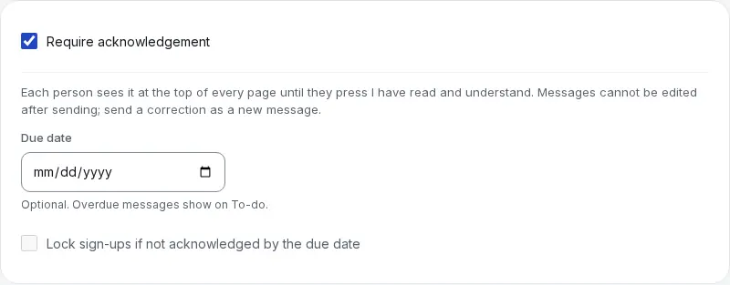
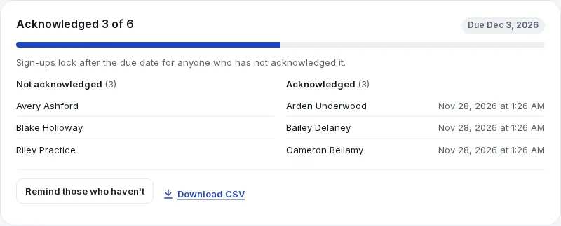

# Messages for staff

Messages work as in the deputy manual's [Messages](../deputy/23-messages.md) chapter, with these differences for coordinators and admins.

1. Open **Messages** and choose **New message**.
2. **Send to** always offers **Everyone**, with the number of people it reaches. Choosing it replaces any chips you picked; **Undo** brings them back. With **Choose recipients**, add people by name, a rank, a detail's roster or the coordinators.

   

3. **About a detail** lists every detail that has not ended, not only your own. Past details are never offered.
4. Your messages always arrive by email and push, whatever each person chose for alerts.

Someone covered by more than one chip, for example by name and by a detail's roster, gets one copy. Vendors cannot be messaged here.

## Messages that require acknowledgement

1. In **New message**, tick **Require acknowledgement**. Optionally set a **Due date**; with a due date you can also tick **Lock sign-ups if not acknowledged by the due date** (off unless you tick it).

   

2. Each recipient sees a banner on **Home** and a thin bar on every page until they press **I have read and understand**, which they can do only after reaching the end of the message. The time is recorded, audited and final.
3. Open the message from **Sent** to track it: **Acknowledged N of M**, who has not acknowledged it and who has (with the time). **Remind those who haven't** sends them an alert through the usual notification settings ("Acknowledgement reminder" under Management, Notifications, with its own email message). **Download CSV** exports the list; each export is audited.

   

4. After the due date, a message that some people have not acknowledged shows on **To-do** under **Messages not acknowledged**. With the lock on, those people cannot sign up until they acknowledge it; you can still assign them with an override reason.

A sent message cannot be edited. Send a correction as a new message. Vendors cannot be messaged here.
