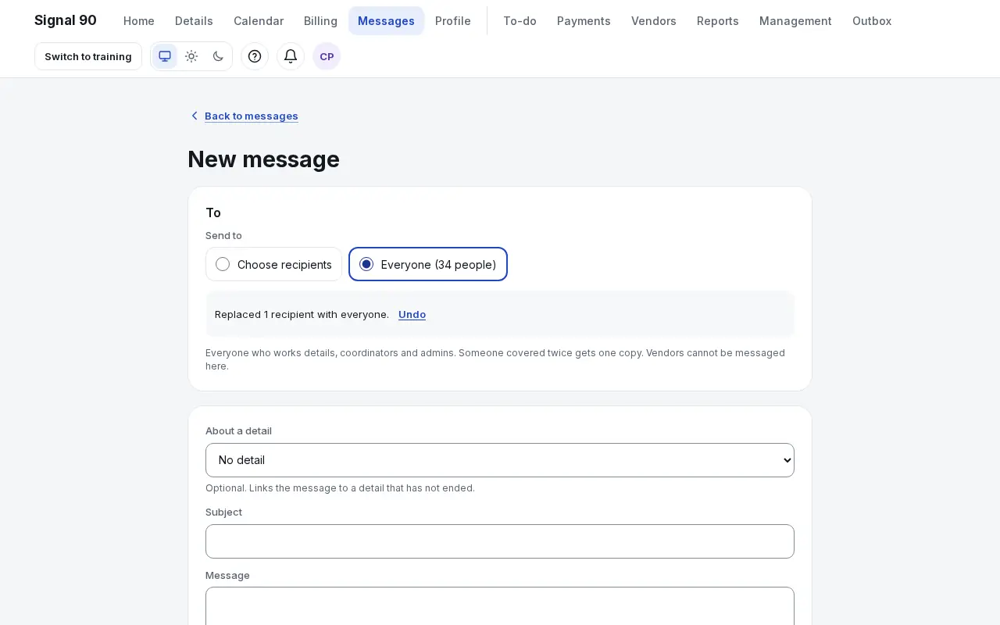

# Messages for staff

Messages work as in the deputy manual's [Messages](../deputy/23-messages.md) chapter, with these differences for coordinators and admins.

1. Open **Messages** and choose **New message**.
2. **Send to** always offers **Everyone**, with the number of people it reaches. Choosing it replaces any chips you picked; **Undo** brings them back. With **Choose recipients**, add people by name, a rank, a detail's roster or the coordinators.

   

3. **About a detail** lists every detail that has not ended, not only your own. Past details are never offered.
4. Your messages always arrive by email and push, whatever each person chose for alerts.

Someone covered by more than one chip, for example by name and by a detail's roster, gets one copy. Vendors cannot be messaged here.
