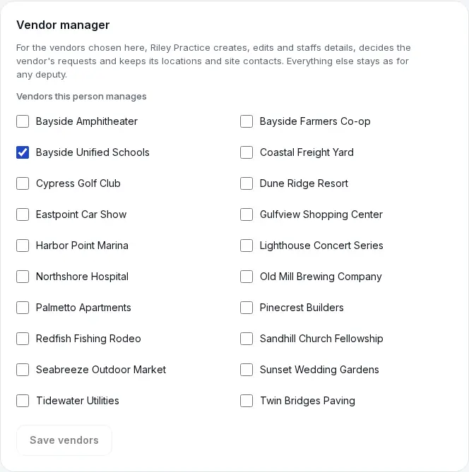

# Vendor managers

A deputy can manage a few chosen vendors for the agency, so a coordinator does not have to. For example, a school resource sergeant can manage the details of two or three schools.

## Choosing the vendors

1. Open **Management**, then **Users**, and open the deputy.
2. Under **Vendor manager**, tick the vendors under **Vendors this person manages** and choose **Save vendors**. Clear every box to stop. Coordinators and admins can do this; the change is kept in the audit log.

   

Only a deputy (personnel) can be a vendor manager. Coordinators and admins manage every vendor already.

## What a vendor manager can do

For the vendors they manage, and only those, a vendor manager:

- Creates and edits details: positions, times, the rate inside the agency range, the description and the contract, and copies and repeats them. Choosing **School Resource Deputy** as a position means only people with that flag can sign up; **Deputy Sheriff** is open to everyone eligible.
- Holds, releases and uses **Release now**.
- Cancels and reactivates details, with the same reason rules.
- Assigns and removes people, with the same conflict and override rules and reasons as a coordinator.
- Sees the roster and sign-up history, decides the vendor's requests and changes, and keeps the vendor's locations and site contacts.

They cannot approve a rate outside the agency range, mark no-shows, name the Incident Commander, put an invoice on hold or waive late cancellation pay. They never see W-9s, other people's payments or invoices, other vendors, the vendor record, staff reports, **To-do**, **Management** or the audit log. For everything else they are a deputy. A confidential detail of their vendor is hidden from them unless they are assigned to it, and then they see it as a deputy, without **Manage** (see [Confidential details](35-confidential-details.md)).

They work on the same screens as everyone. They keep the deputy tabs and get a **Manage** tab (on a phone, under **More**) with their vendors, the requests to decide and the upcoming details. Details and Calendar show **Manage** on their vendors' details, which opens **Manage this detail**.

## Alerts and the audit log

Alerts that go to coordinators about these vendors' details, such as a new vendor request or a change to approve, also go to the vendor manager. Coordinators still get them and still see everything. The vendor manager can switch email or push off for these alerts on their own Alerts list in Profile, inside the agency's switches for coordinators and admins. Every action a vendor manager takes is kept in the audit log under their own name.
