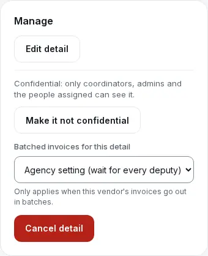
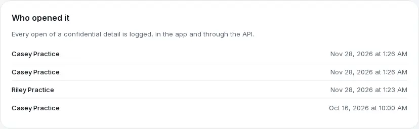

# Confidential details

Mark a detail **Confidential** when only the people working it should know about it, for example VIP or dignitary protection. Only coordinators, admins and the people you assign can see a confidential detail.

## Making a detail confidential

1. On **New detail**, under **Ops plan and release**, tick **Confidential** and give the **Reason for making it confidential**. A copy of a confidential detail starts with the box ticked and needs its own reason.
2. On an existing detail, open **Manage this detail** and choose **Make it confidential** under **Manage**. Give the reason and choose **Make it confidential** again.

   

To undo it, choose **Make it not confidential** and give the reason. The detail then releases on the agency's normal schedule. Turning it on or off always needs a reason, and both are kept in the audit log. Vendor managers cannot change it.

## Staffing it

A confidential detail is never open for sign-up and never released, so **Hold** and **Release** do not show. Add people with **Assign someone**, under the usual conflict and override rules. Making a detail confidential ends its backup list and anyone watching it.

## Who sees it

- Coordinators and admins see it everywhere, with a **Confidential** chip and a lock. In **Details**, **Calendar** and **Map**, the **Confidential details** filter shows them, shows only them, or hides them.
- The people assigned see the whole detail in the app.
- Everyone else, including other deputies, the vendor and the vendor's managers, sees nothing: it is not in any list, the calendar, the map, search, Home, messages or the API. Opening its number (such as /jobs/9) answers as for a detail that does not exist, and **Go to detail #** says "No detail #9 that you can see".

## Emails, alerts and calendar feeds

Email and phone alerts are less private than the app. An alert about a confidential detail only says, for example, "You were assigned to a confidential detail on Dec 4, 2026. Open Signal 90 for the details." Personal calendar feeds show "Confidential detail" with the times only.

## Who opened it

Every time anyone opens a confidential detail, in the app or through the API, Signal 90 logs who and when. **Who opened it**, on **Manage this detail**, lists them, newest first.

## Invoices and reports

Billing works as usual: the deputy bills it and the invoice goes to the vendor's billing email. It shows on **Payments** as usual. Staff reports include confidential details; group a report by **Confidential** to see them apart. A deputy's own earnings and tax summary name it "Confidential detail".
