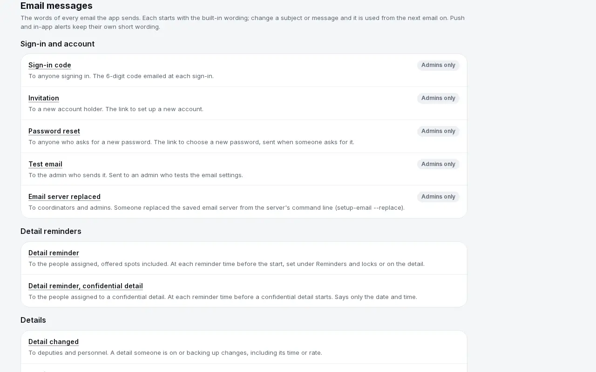
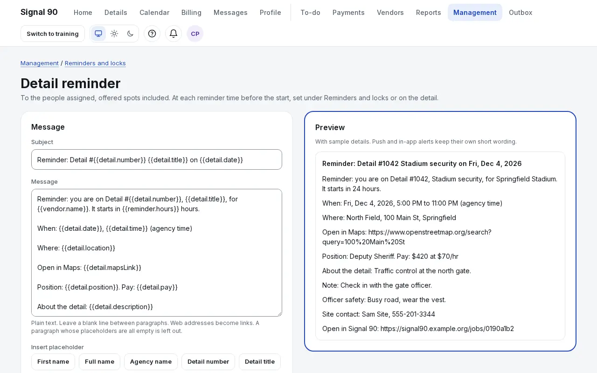

# Email messages

Every email the app sends starts with a built-in message. Coordinators and admins can change the subject and the text of each one.

1. Open **Management**, then **Reminders and locks**. Below the reminder settings, **Email messages** lists every email in groups such as **Sign-in and account**, **Detail reminders**, **Details** and **Invoices to vendors**. Each one says who gets it and when it goes out, and **Changed** marks the ones the agency has edited.

   

2. Choose a message to open it. Change the **Subject** and the **Message**. Leave a blank line between paragraphs. Web addresses you type become links.
3. To add a fact that changes with each email, such as the detail number or the person's first name, put the cursor where it goes and choose its button under **Insert placeholder**. It appears as, for example, `{{detail.number}}`. A paragraph whose placeholders are all empty is left out, so a line like "Note: {{reminder.note}}" disappears when a detail has no note.

   

4. **Preview** shows the email with sample details as you type.
5. Choose **Send me a test** to send it, with the sample details, to your own email address. In training mode it goes to the email outbox.
6. Choose **Save message**. It is used from the next email on. The page shows who changed it and when, and every change is kept in the audit log with the wording before and after.
7. **Reset to default** puts back the built-in message.

## Rules that keep email safe

- **Required facts stay.** The sign-in code, the account setup link, the password reset link, and the invoice number and amount in invoice emails cannot be removed. Saving without one says, for example, "The sign-in code must stay in this message."
- **Admins only.** Sign-in code, invitation, password reset, test email and email server alerts can be changed only by admins. Coordinators can open them, preview them and send themselves a test.
- **Confidential details.** Messages for confidential details are separate, and they can use only the date and time. Saving one with the title, location, vendor, description or note is refused, so nothing about the detail leaves the app.
- **Only listed placeholders.** A placeholder the message does not offer, or a missing brace, is refused when saving.
- **Facts are shown as text.** A vendor name or a description can never add a link or change the layout of the email.

Push and in-app alerts keep their own short, fixed wording. Most alert emails start as the alert's title and text (`{{alert.title}}` and `{{alert.body}}`); you can add words around them.
