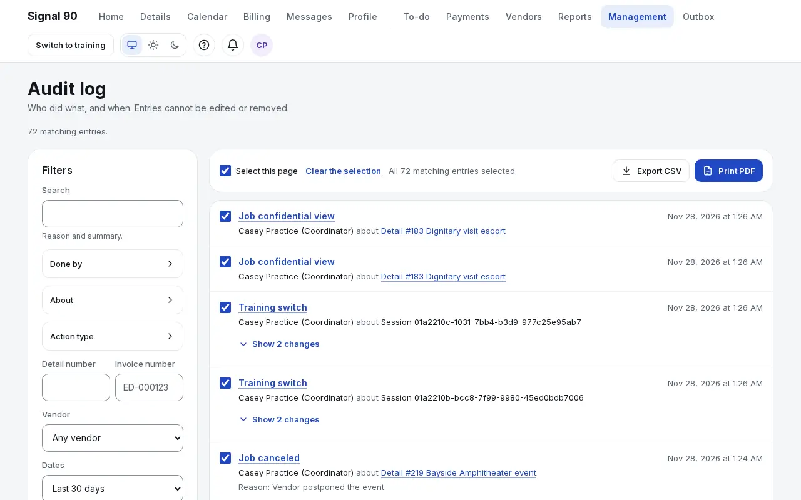
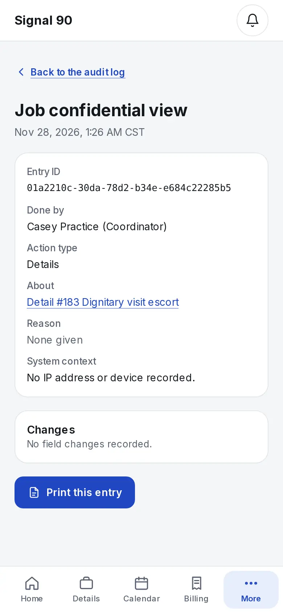
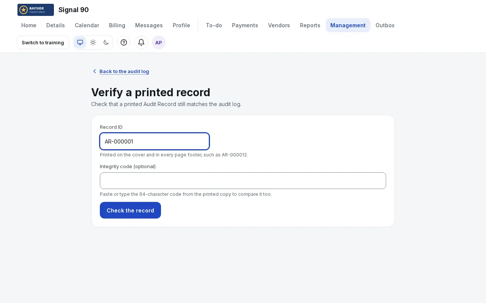

# Audit log, exports and printed records

The audit log keeps every action as it happens: who did it, when, what changed and why. Entries cannot be edited or deleted in the app. Coordinators and admins can read it.

## Finding entries

1. Open **Management**, then **Audit log**. Entries show newest first, 50 to a page, with the number that match.
2. Use the **Filters** (on a phone, choose **Filters** to open them):
   - **Search** finds text in the reason and the summary.
   - **Done by** shows every action one person performed. **About** shows every entry where a person is the subject, such as being removed from a detail, a W-9 approved or a suspension. Type part of a name to find them.
   - **Action type** picks one or more groups in plain words: sign-ins and security, details, sign-ups and assignments, billing and invoices, payments, W-9s, users and roles, vendors, settings, messages and exports.
   - **Detail number**, **Invoice number** and **Vendor**.
   - **Dates**: today, the last 7 days, the last 30 days, this year, or a custom range, in agency time.
   - **System actions**: include or leave out what the system did on its own.
   - **Order**: newest or oldest first.

   Choose **Apply**. The filters are in the page address, so a copied link shares them. **Reset** clears them.

   

3. Choose an entry's name to open it in full, with every changed field before and after.

## Exporting and printing

1. Tick the entries you want, or **Select this page**. **Select all N matching** picks every entry the filters match, not only this page.
2. **Export CSV** downloads a spreadsheet with the entry ID, the time (agency time, with the time zone), who did it and their role, the action, who or what it is about, the detail, vendor and invoice, the reason, the changes, the IP address if one was recorded, and whether a person or the system did it.
3. **Print PDF** makes an **Audit Record**, a formal record suitable for presentation, discipline or court. Its cover shows the agency, the filters used, the number of entries, who made it and when, and a **record ID** and **integrity code**. Each entry follows with its time, who did it, what it was about, the reason, a before and after table and the system context. Every page footer shows the page number, the record ID and the integrity code, and the record ends with **Prepared by** and **Reviewed by** signature lines. Over 2,000 entries, it asks first; narrowing the filters keeps it short.
4. To print one entry, open it and choose **Print this entry**.

Every export and print is itself kept in the audit log, with who made it, the filters and the number of entries. Passwords, sign-in codes, tokens, API key secrets, file contents and W-9 details never appear in an export or a print, only references to them.

   

## Checking a printed record

Admins can check that a printed Audit Record still matches the audit log.

1. On **Audit log**, choose **Verify a printed record**.
2. Enter the **Record ID** from the cover or any page footer, such as AR-000012. To compare the printed code too, enter the **Integrity code**.
3. Choose **Check the record**. It says whether the entries are unchanged since the record was printed and whether the code you entered is that record's code.

   
