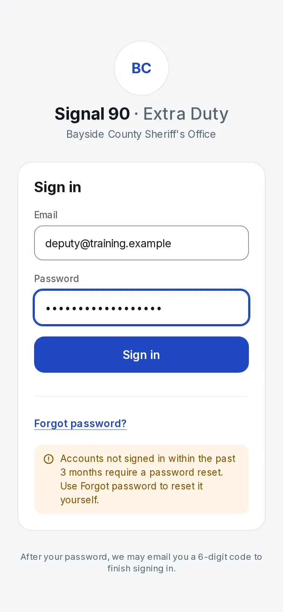
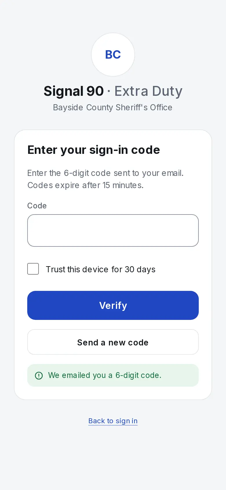

# Signing in

You sign in with a password and, unless your agency has turned codes off for deputies, a 6-digit code sent to your email. There is no authenticator app.

1. Open the Signal 90 site. Enter your **Email** and **Password**, then choose **Sign in**.

   

2. Check your email for the 6-digit code. Type it in **Code**.
3. If this is your own phone or computer, tick **Trust this device for 30 days**. You will not be asked for a code on this device for 30 days.
4. Choose **Verify**.

   

## If something goes wrong

- No code arrived: choose **Send a new code**. Codes expire after 15 minutes.
- Forgot your password: choose **Forgot password?** on the Sign in page and follow the email.
- An account that has not signed in for a few months must reset its password first. The amber note on the Sign in page says so.

> On a shared computer, leave **Trust this device for 30 days** unticked, and sign out from **Profile** when you are done.
