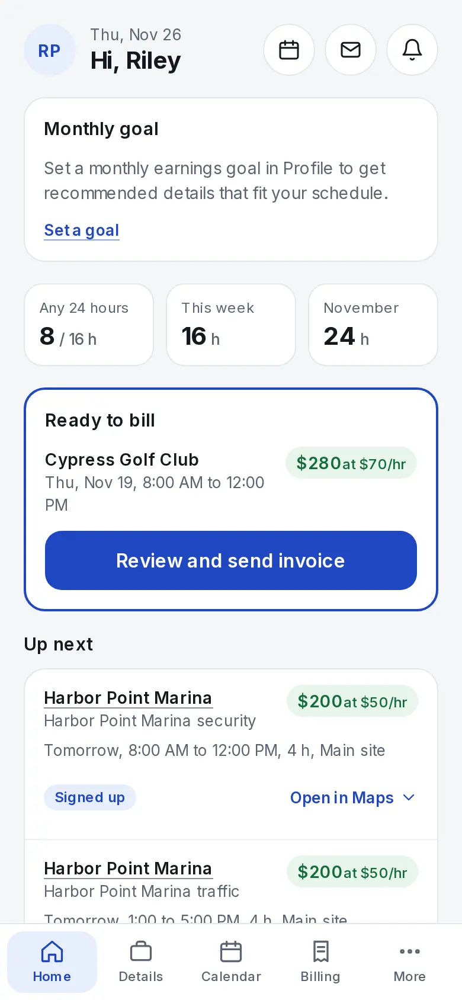
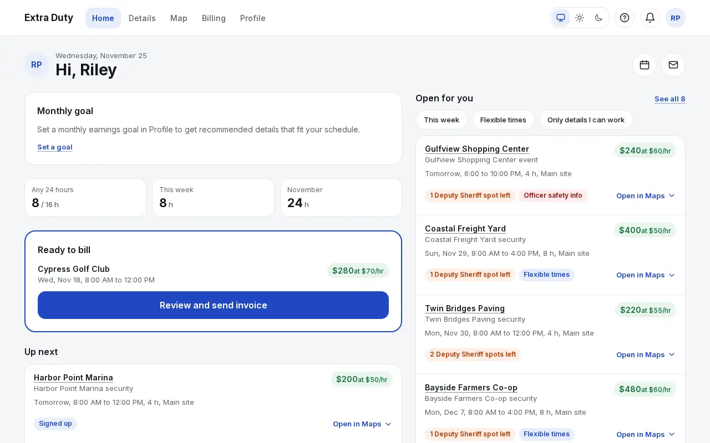
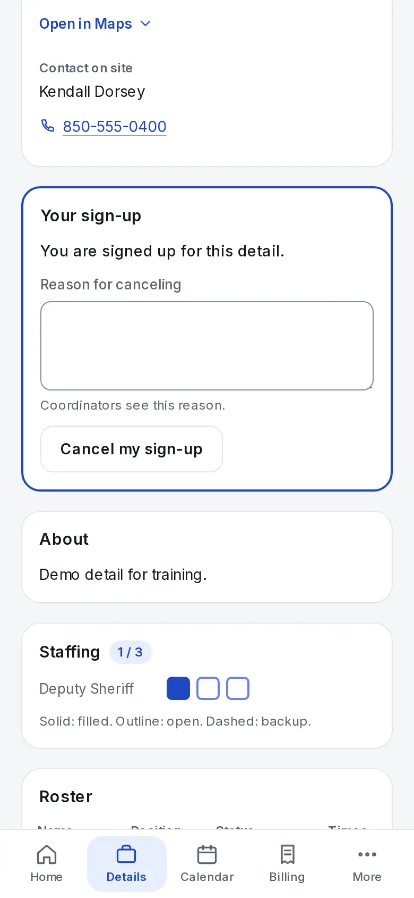

# Getting around on a phone and a desktop

Extra Duty works the same on a phone and a computer. Only the menus move.

1. On a phone, the bar at the bottom of the screen has your five sections: **Home**, **Details**, **Map**, **Billing** and **Profile**. The section you are in is shaded. The top of Home has buttons for the calendar, messages and alerts.

   

2. On a computer, the same sections are across the top. On the right are the theme switch, Help, the alerts bell and your initials, which open **Profile**.

   

3. Links in Extra Duty are underlined. Links that do something, such as **Open in Maps**, have an icon. Phone numbers and email addresses show in full with a phone or mail icon. Tap a phone number to call it, or an email address to write to it.

   

## Help

This manual is in the app. On a computer, choose the question mark in the top bar. On a phone, open **Profile** and choose **Help and user manual**.

> You can add Extra Duty to your phone's home screen from the browser's share or menu button. It then opens like an app.
