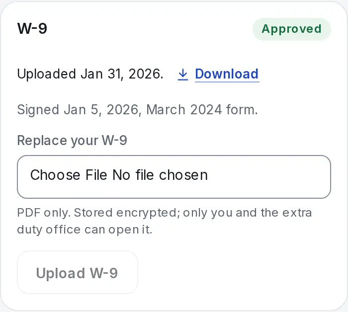

# Your profile and W-9

Vendors often ask for a W-9 with your first invoice. Keep one on file so you can attach it when you bill.

1. Open **Profile**.
2. Find the **W-9** card. It says whether a W-9 is on file.
3. Under **Upload your W-9**, choose your W-9 file. It must be a PDF.
4. Choose **Upload W-9**.

   

The file is stored encrypted. Only you and the extra duty office can open it, and every time someone opens it, it is logged.

## Good to know

- Upload a new W-9 the same way. The newest one is used from then on.
- When you bill a detail, you can tick **Attach my W-9** to send it with that invoice. See [Billing a detail](14-billing-a-detail.md).
