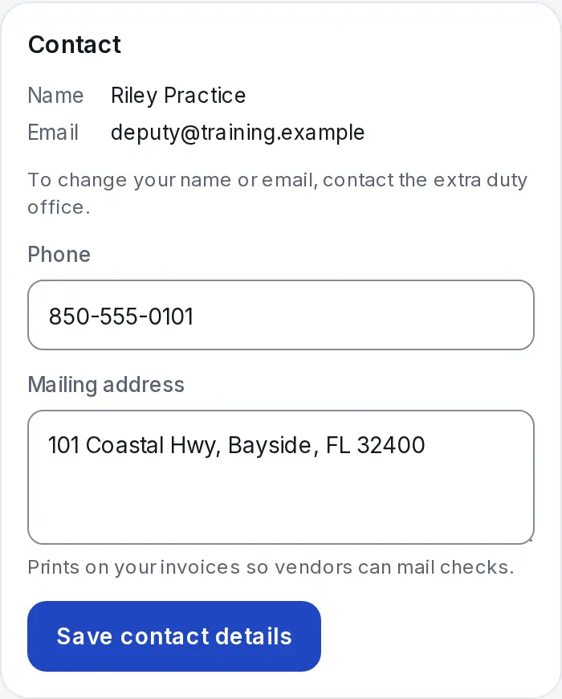

# Your phone and mailing address

Your mailing address prints on your invoices, so vendors can mail you a check.

1. Open **Profile** and find the **Contact** card.
2. Check **Phone**. It must be 10 digits, shown as 850-555-0101.
3. Type your **Mailing address** as it should appear on an envelope.
4. Choose **Save contact details**.

   

> To change your name or email, contact the extra duty office. You cannot change them yourself.
