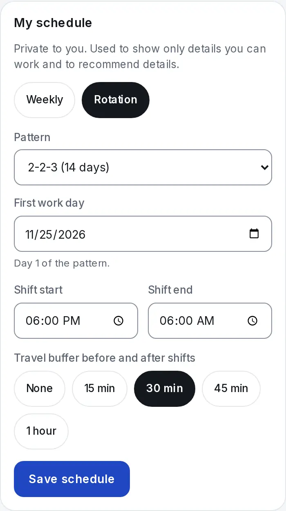
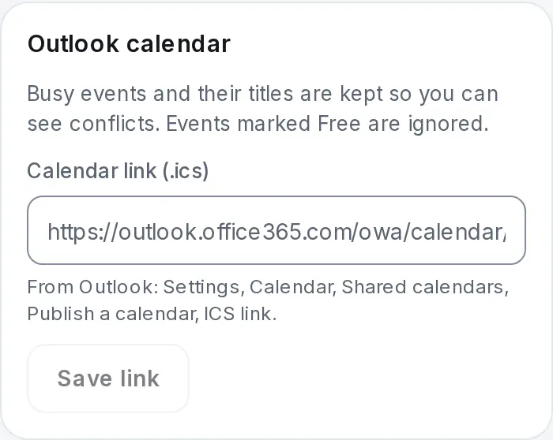
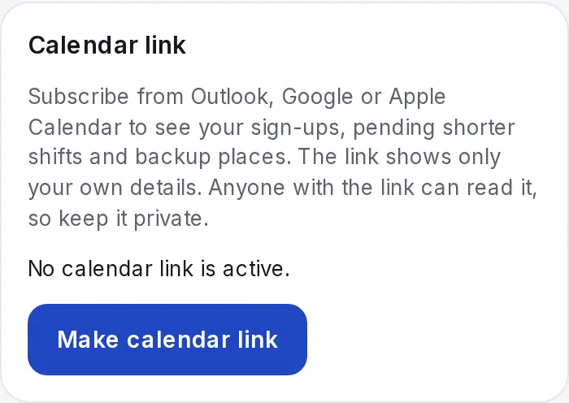

# Your work schedule and calendar link

Tell Extra Duty when you are on duty. It then shows which details you can work and recommends details that fit. Your schedule is private to you.

1. Open **Profile** and find **My schedule**.
2. Choose **Weekly** if you work the same days every week, or **Rotation** for a repeating pattern. For a rotation, pick the **Pattern** and the **First work day** (day 1 of the pattern).
3. Set **Shift start** and **Shift end**, and a **Travel buffer before and after shifts**. Choose **Save schedule**.

   

4. Check the **Next 4 weeks** preview. For leave, a swap or an extra shift, choose **Add a one-off change**.
5. To see your Outlook appointments as busy time, paste your published calendar link in **Calendar link (.ics)** under **Outlook calendar**, then choose **Save link**. In Outlook, the link is under Settings, Calendar, Shared calendars, Publish a calendar, ICS link.

   

6. To see your details in your own phone calendar, open **Details**, then **Calendar**. Under **Calendar link**, choose **Make calendar link** and add the link to Outlook, Google or Apple Calendar.

   

> Anyone with your calendar link can read it, so keep it private. The link shows only your own sign-ups, pending shorter shifts and backup places.
