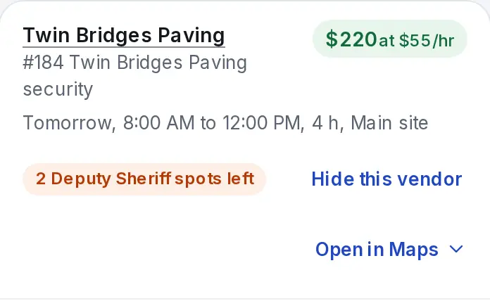
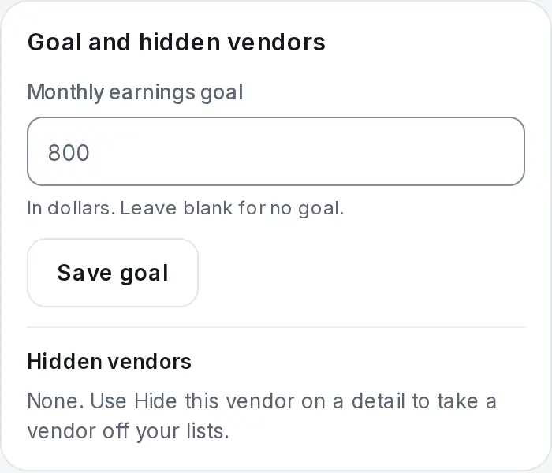

# Hiding vendors you do not want to work for

Hide a vendor to take its details off your lists and the map. You can bring it back at any time.

1. In **Details**, find a detail from that vendor and choose **Hide this vendor**.

   

2. To see or undo your hidden vendors, open **Profile** and find **Goal and hidden vendors**. Hidden vendors are listed under **Hidden vendors**, each with **Show again**.

   

## Monthly earnings goal

On the same card, type a **Monthly earnings goal** in dollars and choose **Save goal**. Home then shows your progress and recommends details that fit your schedule. Leave it blank for no goal.
