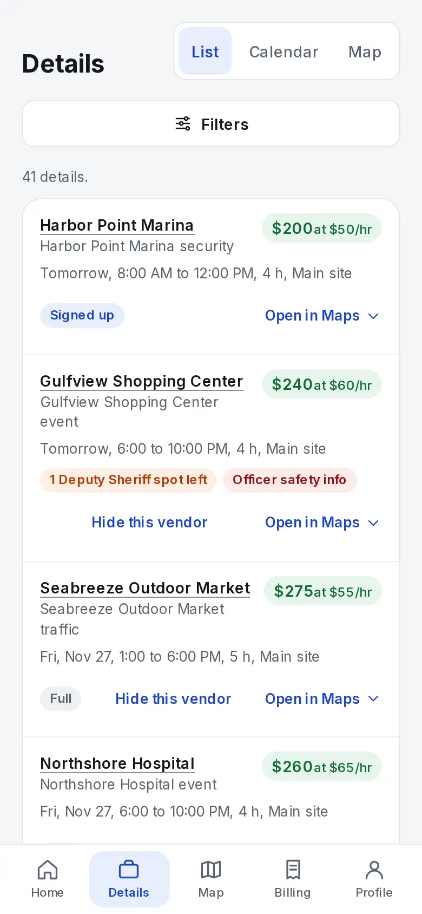
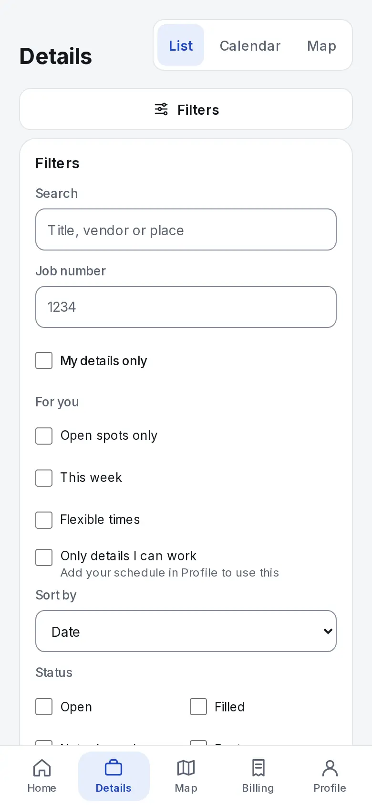
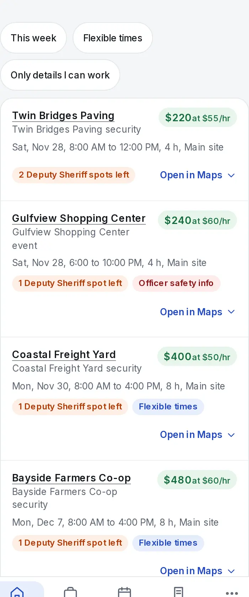

# Finding and sorting details

1. Open **Details**. Every detail you can see is listed with its pay, time, place and open spots. Pay always shows as the total and the hourly rate, such as "$200 at $50/hr".

   

2. Choose **Filters** to narrow the list. You can search by title, vendor or place, or by **Job number**, and tick **My details only**, **Open spots only**, **This week**, **Flexible times** or **Only details I can work**. Pick **Sort by** Date, Total pay, Rate or Vendor. Choose **Apply**.

   

3. Tick **Remember my filters** to keep them for next time. **Reset** clears them. Filters change only your own view.
4. On **Home**, **Open for you** has quick filters: **This week**, **Flexible times** and **Only details I can work**. **See all** opens the full list.

   

## What the labels mean

- **1 Deputy Sheriff spot left**: open spots, by position.
- **Full**: every spot is taken. You can still join the backup list.
- **Flexible times**: you may pick your own start and end inside a window.
- **Officer safety info**: read the safety notes before you go.
- **Not released yet**: you can see it, but sign-up opens at the time shown.

> **Only details I can work** needs your schedule in Profile. See [Your work schedule](05-work-schedule-and-calendar-link.md).
