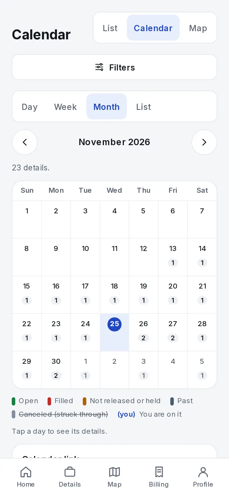

# The calendar

The calendar shows every detail you are allowed to see, by day.

1. Open **Details** and choose **Calendar**.
2. Pick **Day**, **Week**, **Month** or **List**. Use the arrows to move between months. On a phone, tap a day to see its details.

   

3. Each detail has a colored stripe. The **Color key** under the calendar says what each color means: **Open**, **Filled**, **Not released or held**, **Past** and **Canceled (struck through)**. **(you)** marks the details you are on.

   

4. Choose **Filters** to show only some details, for example **My details only**, a status, a vendor or a **Person signed up**. Choose **Apply**.

> The color is never the only clue. Every detail also says its status in words.
