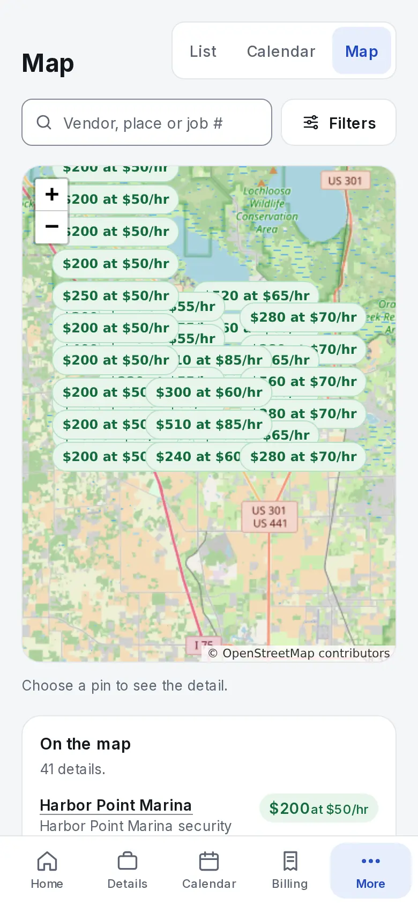
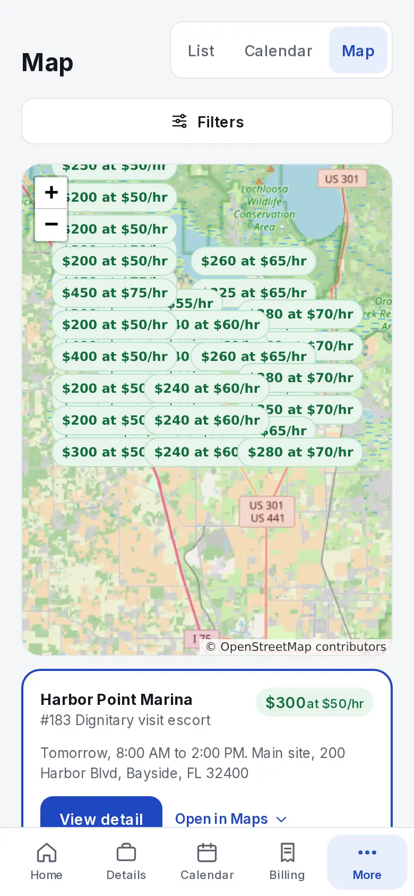

# The map

1. Open **Map**. Each pin shows a detail's pay.

   

2. Use the buttons over the map to show only **Open**, **Mine**, **This week** or **Flexible times** details, or one detail type. Turn on **Only details I can work** to hide details that clash with your schedule.
3. Choose a pin. A card shows the detail with **View detail** and **Open in Maps**.

   

4. Pinch or use **+** and **-** to zoom.
