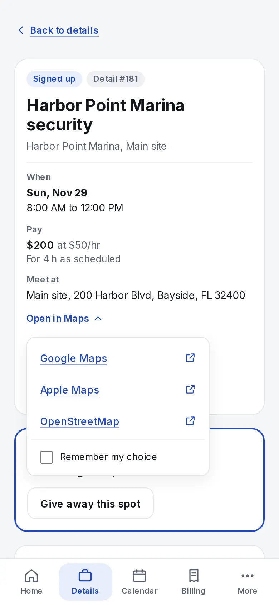

# Getting directions with Open in Maps

Every address in Extra Duty has an **Open in Maps** link.

1. On a detail, choose **Open in Maps**.
2. Pick **Google Maps**, **Apple Maps** or **OpenStreetMap**. The map opens in a new tab, at the pinned spot when the detail has one.

   

3. To skip the menu next time, tick **Remember my choice** before you pick. From then on the link opens your app straight away, and a small **Other maps** button beside it opens the menu.

To change your choice later, open **Profile** and find **Maps**.
